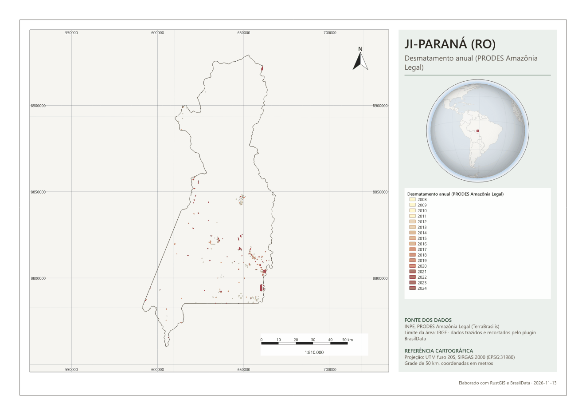

# Desmatamento anual (PRODES Amazônia Legal)

<!-- Gerado por scripts/gerar.py a partir do fontes.csv e do fichas.csv; não edite à mão. -->

O desmatamento anual do bioma Amazônia (na Amazônia Legal) mapeado pelo INPE (PRODES): os polígonos de vegetação nativa suprimida a cada ano.

*Mapa exemplo: Ji-Paraná (RO), feito com o plugin.*

| | |
|---|---|
| **Onde na aba** | Vegetação e meio ambiente › Desmatamento |
| **Fonte** | INPE |
| **Período** | de 2008 até o último ano publicado (o ano PRODES vai de agosto a julho). |
| **Resolução ou escala** | imagens Landsat e equivalentes, 30 m; área mínima de 1 a 6,25 ha. |
| **Unidades** | área em km² (area_km) |
| **Legenda** | Polígonos pelo ano do desmatamento (year), com a classe (class_name), a data da imagem e o satélite. |
| **Cuidados de uso** | Mapeia o corte raso da vegetação nativa, não a degradação nem a regeneração. Polígonos menores que a área mínima (1 ha no Cerrado e na Mata Atlântica, 6,25 ha na Amazônia) ficam de fora; nuvens escondem parte de alguns anos. |
| **Licença** | CC BY-SA 4.0 |
| **Citação** | INPE, PRODES Amazônia Legal (TerraBrasilis). |
| **App desktop** | sim |
| **App web** | sim |

[Todas as camadas](README.md)
