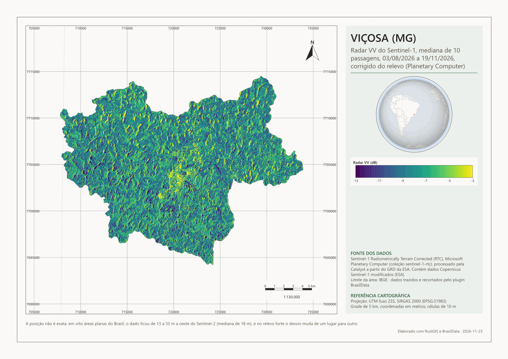

# Radar 10 m, mediana no tempo (Sentinel-1)

<!-- Gerado por scripts/gerar.py a partir do fontes.csv e do fichas.csv; não edite à mão. -->

O retroespalhamento do radar Sentinel-1 (banda C) em 10 m, corrigido do relevo: a mediana das passagens mais recentes da mesma órbita, como no Sentinel-1 Global Backscatter Model.

*Mapa exemplo: Viçosa (MG), feito com o plugin.*

| | |
|---|---|
| **Onde na aba** | Vegetação e meio ambiente › Uso e cobertura. |
| **Fonte** | Microsoft Planetary Computer (Catalyst; ESA Copernicus). |
| **Período** | as passagens mais recentes da mesma órbita (de 2 a 30, uma a cada 12 dias). |
| **Resolução ou escala** | 10 m |
| **Unidades** | dB (gama0) |
| **Legenda** | Viridis: água e sombra do relevo escuras, mata e pasto em verde e azul, cidade e encostas viradas para o satélite em amarelo. |
| **Cuidados de uso** | A mediana de várias passagens tira o granulado sem borrar as bordas, mas mistura as estações do ano: muitas passagens apagam a mudança de uma lavoura. O relevo íngreme deixa sombras e encostas claras. A posição não é exata: em oito áreas planas do Brasil, o dado ficou de 13 a 33 m a oeste do Sentinel-2 (mediana de 18 m; medido em 22/11/2026), e no relevo forte o desvio muda de um lugar para outro; confira antes de sobrepor a outro dado de 10 m. A resolução real do GRD é de cerca de 20 × 22 m, em pixels de 10 m. Precisa do RustGIS desktop ou de linha de comando (a janela remota); áreas de até cerca de 220 km. |
| **Licença** | CC-BY 4.0, com citação |
| **Citação** | Sentinel-1 Radiometrically Terrain Corrected (RTC), Microsoft Planetary Computer, coleção sentinel-1-rtc, processado pela Catalyst a partir do GRD da ESA; contém dados Copernicus Sentinel-1 modificados (ESA). |
| **App desktop** | sim |
| **App web** | No app web: a leitura da janela remota só existe no desktop e na linha de comando. |

[Todas as camadas](README.md)
