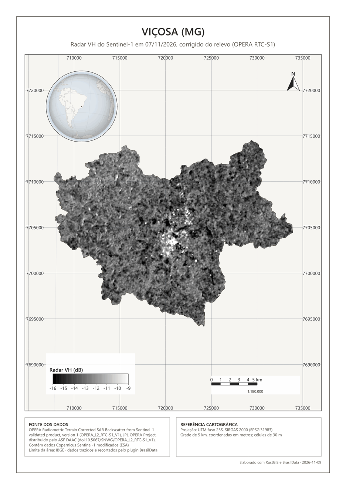

# Radar VH (Sentinel-1, OPERA)

<!-- Gerado por scripts/gerar.py a partir do fontes.csv e do fichas.csv; não edite à mão. -->

O retroespalhamento do radar Sentinel-1 na polarização VH, que responde mais ao volume da vegetação.

*Mapa exemplo: Viçosa (MG), feito com o plugin.*

| | |
|---|---|
| **Onde na aba** | Vegetação e meio ambiente › Uso e cobertura. |
| **Fonte** | NASA/JPL OPERA (ASF DAAC); Sentinel-1 da ESA. |
| **Período** | a passagem mais recente, ou a do dia escolhido. |
| **Resolução ou escala** | 30 m |
| **Unidades** | dB |
| **Legenda** | Escala de cinza: mata é mais clara que pasto e solo exposto; água é preta. |
| **Cuidados de uso** | O radar enxerga através das nuvens, mas o relevo íngreme deixa sombras e distorções mesmo corrigido. Uma passagem é um instante: a umidade do solo e da vegetação muda o sinal de um dia para o outro. |
| **Licença** | dados da NASA sem restrição de uso, com citação; dados Copernicus Sentinel de uso livre e gratuito. |
| **Citação** | OPERA RTC-S1 V1, JPL OPERA Project, ASF DAAC, doi:10.5067/SNWG/OPERA_L2_RTC-S1_V1; contém dados Copernicus Sentinel-1 modificados. |
| **App desktop** | sim |
| **App web** | No app web: depende do login Earthdata, que o RustGIS guarda no desktop; ainda não testado no web. |

[Todas as camadas](README.md)
