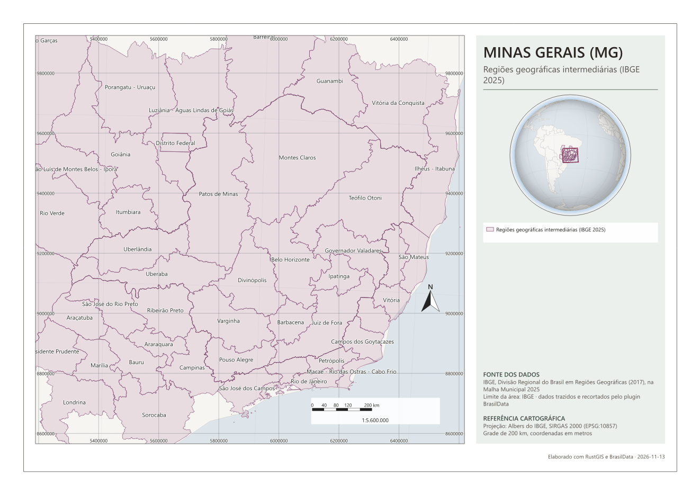

# Regiões geográficas intermediárias (IBGE 2025)

<!-- Gerado por scripts/gerar.py a partir do fontes.csv e do fichas.csv; não edite à mão. -->

As regiões geográficas intermediárias da divisão regional do IBGE de 2017, organizadas em torno de cidades que articulam as regiões imediatas.

*Mapa exemplo: Minas Gerais, feito com o plugin.*

| | |
|---|---|
| **Onde na aba** | Território › Limites |
| **Fonte** | IBGE |
| **Período** | divisão de 2017, nos limites da Malha Municipal 2025. |
| **Resolução ou escala** | escala 1:250.000 |
| **Unidades** | sem unidade |
| **Legenda** | Um polígono por região, com o código e o nome (cd_rgint, nm_rgint). |
| **Cuidados de uso** | Limites para mapas e estatística, não para demarcação legal. Vem o polígono inteiro de cada unidade que cruza a área, sem recorte. Substitui as mesorregiões de 1989 nas estatísticas do IBGE. |
| **Licença** | uso livre com citação da fonte |
| **Citação** | IBGE, Divisão Regional do Brasil em Regiões Geográficas (2017), na Malha Municipal 2025. |
| **App desktop** | sim |
| **App web** | sim |

[Todas as camadas](README.md)
