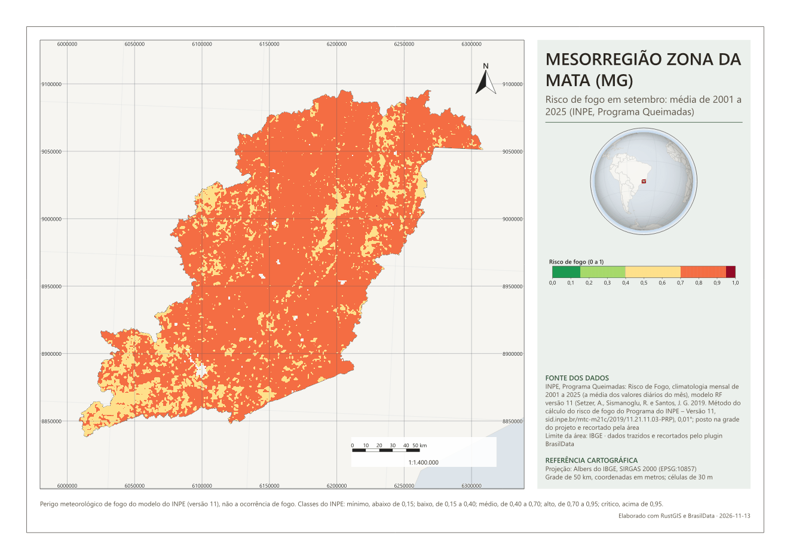

# Risco de fogo (INPE)

<!-- Gerado por scripts/gerar.py a partir do fontes.csv e do fichas.csv; não edite à mão. -->

O perigo meteorológico de fogo do modelo de Risco de Fogo do INPE: dias de secura, umidade, temperatura, vegetação, relevo e latitude.

*Mapa exemplo: Zona da Mata (MG), feito com o plugin.*

| | |
|---|---|
| **Onde na aba** | Vegetação e meio ambiente › Queimadas |
| **Fonte** | INPE (Programa Queimadas) |
| **Período** | climatologia de um mês: a média de 2001 a 2025. |
| **Resolução ou escala** | 0,01° (cerca de 1 km) |
| **Unidades** | índice de 0 a 1 |
| **Legenda** | Cinco classes do INPE: mínimo (abaixo de 0,15), baixo (até 0,40), médio (até 0,70), alto (até 0,95) e crítico. |
| **Cuidados de uso** | É a média de 25 anos, não a previsão de hoje; o risco do dia está no portal do Programa Queimadas. |
| **Licença** | licença não declarada nos arquivos; uso com a citação do INPE e do método. |
| **Citação** | INPE, Programa Queimadas: Risco de Fogo, climatologia mensal de 2001 a 2025, modelo RF versão 11 (Setzer, Sismanoglu e Santos 2019). |
| **App desktop** | sim |
| **App web** | a confirmar |

[Todas as camadas](README.md)
