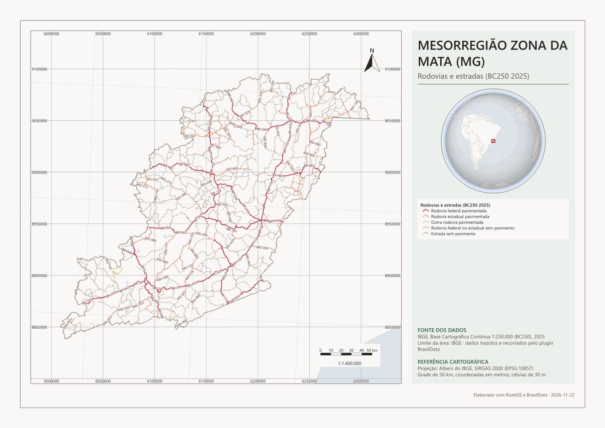

# Rodovias e estradas (BC250 2025)

<!-- Gerado por scripts/gerar.py a partir do fontes.csv e do fichas.csv; não edite à mão. -->

Os trechos rodoviários da Base Cartográfica Contínua do IBGE: rodovias federais, estaduais e municipais e as estradas de terra, com a jurisdição, o revestimento e a sigla (BR-120, MG-280).

*Mapa exemplo: Zona da Mata (MG), feito com o plugin.*

| | |
|---|---|
| **Onde na aba** | Infraestrutura › Transportes |
| **Fonte** | IBGE |
| **Período** | BC250, edição 2025 |
| **Resolução ou escala** | escala 1:250.000 (eixo das rodovias) |
| **Unidades** | sem unidade; número de pistas e de faixas (nrpistas, nrfaixas). |
| **Legenda** | Linhas por jurisdição e revestimento: federais pavimentadas em vermelho, estaduais pavimentadas em laranja, outras pavimentadas em amarelo, as sem pavimento tracejadas em marrom. De longe aparecem só as federais; de 1:1.500.000 para perto, todos os trechos. A sigla das federais e estaduais pavimentadas aparece de 1:2.000.000 para perto. |
| **Cuidados de uso** | Escala regional: faltam as ruas e boa parte das estradas vicinais (para o detalhe local, Ruas e estradas do OpenStreetMap). A jurisdição é desconhecida em metade dos trechos, quase todos estradas de terra. Com a área do Brasil, o país inteiro vem em 7 páginas (uns 125 mil trechos). |
| **Licença** | uso livre com citação da fonte |
| **Citação** | IBGE, Base Cartográfica Contínua 1:250.000 (BC250), 2025. |
| **App desktop** | sim |
| **App web** | sim |

[Todas as camadas](README.md)
