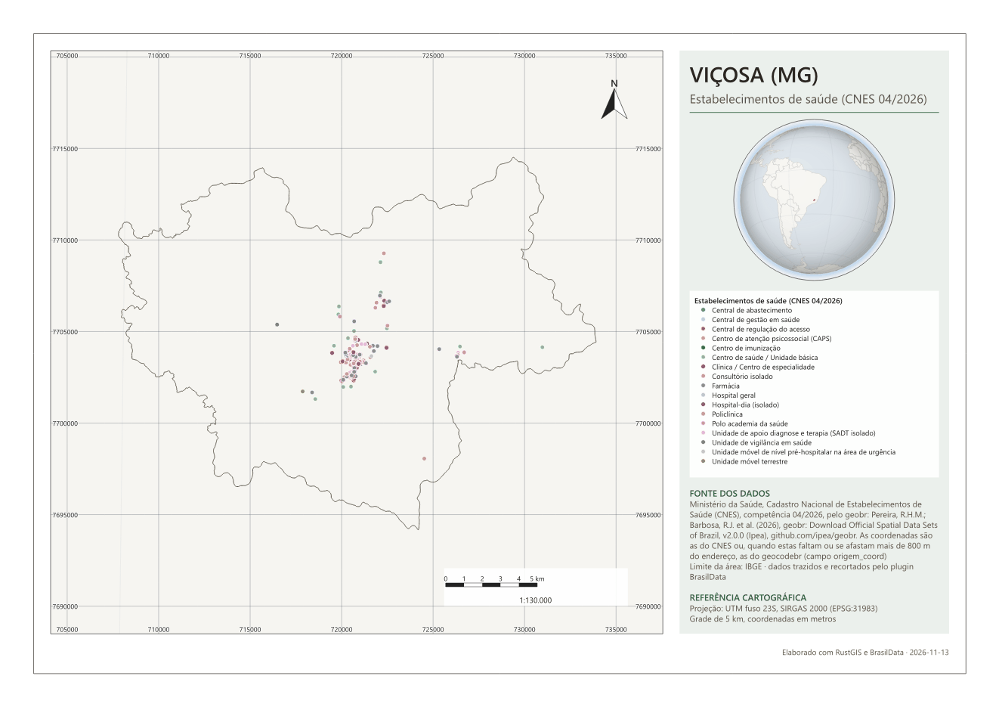

# Estabelecimentos de saúde (CNES, DATASUS)

<!-- Gerado por scripts/gerar.py a partir do fontes.csv e do fichas.csv; não edite à mão. -->

Os estabelecimentos de saúde ativos do CNES: hospitais, unidades básicas, clínicas, laboratórios...

*Mapa exemplo: Viçosa (MG), feito com o plugin.*

| | |
|---|---|
| **Onde na aba** | Saúde › Estabelecimentos |
| **Fonte** | Ministério da Saúde (CNES, pelo geobr do Ipea). |
| **Período** | competência 04/2026 |
| **Resolução ou escala** | pontos (coordenada do CNES ou do endereço). |
| **Unidades** | sem unidade |
| **Legenda** | Pontos pelo tipo de estabelecimento, com o nome, a natureza jurídica, a gestão e o bairro. Os de pessoa física ficam de fora. |
| **Cuidados de uso** | Coordenadas do CNES, ou geocodificadas pelo endereço quando faltam ou se afastam mais de 800 m. |
| **Licença** | dados abertos do Ministério da Saúde, com citação da fonte; geobr sob licença MIT. |
| **Citação** | Ministério da Saúde, Cadastro Nacional de Estabelecimentos de Saúde (CNES), competência 04/2026, pelo geobr (Ipea). |
| **App desktop** | sim |
| **App web** | não: só no desktop |

[Todas as camadas](README.md)
