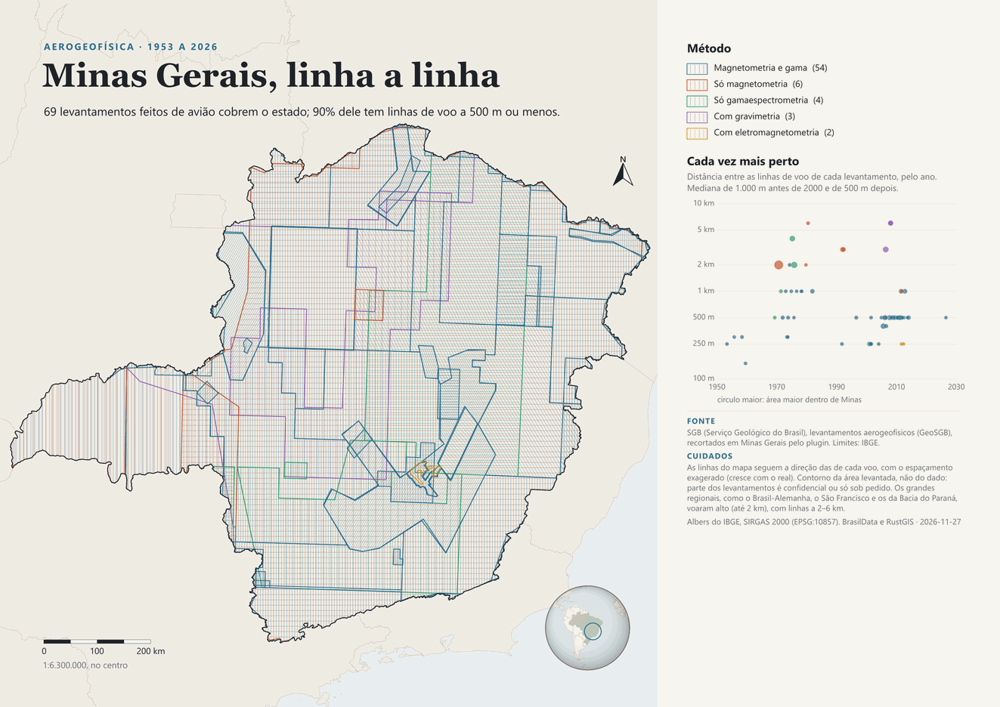

# Levantamentos aerogeofísicos (SGB)

<!-- Gerado por scripts/gerar.py a partir do fontes.csv e do fichas.csv; não edite à mão. -->

As áreas dos levantamentos aerogeofísicos do Brasil cadastrados pelo SGB (magnetometria, gamaespectrometria, gravimetria, eletromagnetometria), com onde obter os dados de cada um.

*Mapa exemplo: Minas Gerais, com o dado do plugin e a folha feita à parte no RustGIS.*

| | |
|---|---|
| **Onde na aba** | Meio físico › Geofísica |
| **Fonte** | SGB (Serviço Geológico do Brasil), pelo GeoSGB. |
| **Período** | levantamentos de 1953 em diante (campo ANO_CONCLUSAO). |
| **Resolução ou escala** | polígonos das áreas levantadas; o espaçamento das linhas de voo (ESPACAMENTO_LV_M) e a altura de voo (ALTURA_VOO_M) dizem o detalhe. |
| **Unidades** | m (altura de voo, espaçamento das linhas de voo), km (espaçamento das linhas de controle), km² (área). |
| **Legenda** | Contornos coloridos pelo método: magnetometria e gamaespectrometria, só gamaespectrometria, só magnetometria, com gravimetria, com eletromagnetometria. |
| **Cuidados de uso** | O campo onde_obter traz o link da página do levantamento na GeoSGB (o download lá pede login), o do servidor de arquivos do SGB ou a instrução de pedir à CBPM, à CNEN, à ANP ou à CODE. Os levantamentos antigos, de linhas espaçadas, não servem para estudos de detalhe. |
| **Licença** | dados abertos do SGB; licença não declarada no serviço. |
| **Citação** | SGB (Serviço Geológico do Brasil), GeoSGB, Levantamentos aerogeofísicos (geofisica/aerogeofisica). |
| **App desktop** | sim |
| **App web** | sim: o ArcGIS do SGB libera a leitura pelo navegador; ainda não testado. |

[Todas as camadas](README.md)
