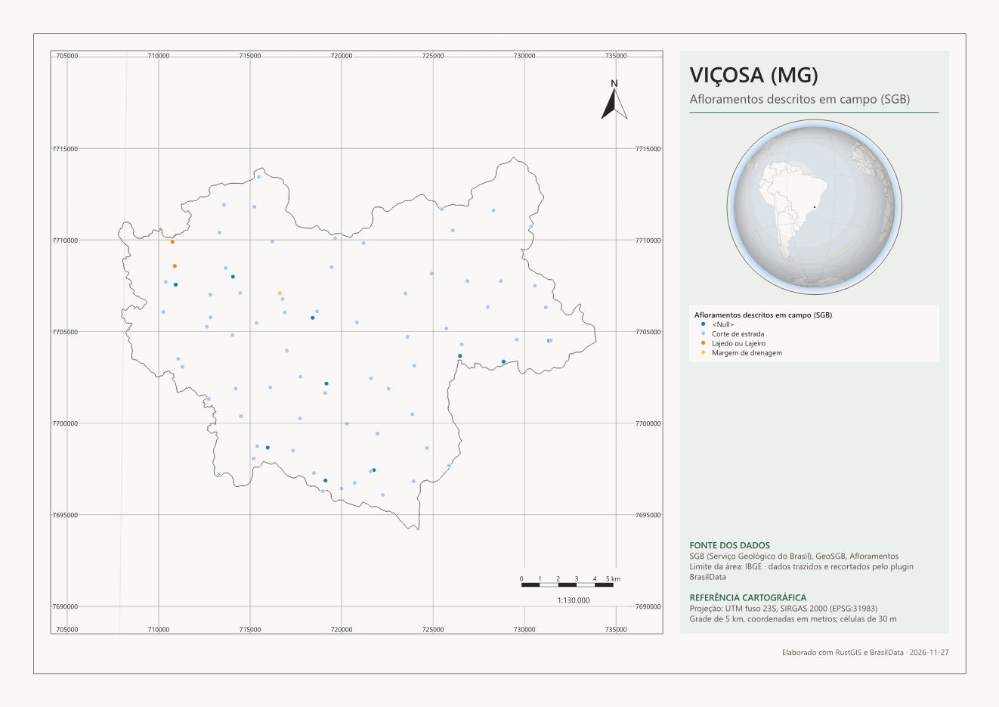

# Afloramentos descritos em campo (SGB)

<!-- Gerado por scripts/gerar.py a partir do fontes.csv e do fichas.csv; não edite à mão. -->

Os afloramentos de rocha descritos pelos geólogos do SGB nos trabalhos de campo, com as rochas e a descrição.

*Mapa exemplo: Viçosa (MG), feito com o plugin.*

| | |
|---|---|
| **Onde na aba** | Meio físico › Geologia e recursos minerais. |
| **Fonte** | SGB (Serviço Geológico do Brasil) |
| **Período** | levantamentos de campo de várias décadas (data do cadastro de cada ponto). |
| **Resolução ou escala** | pontos: a posição do afloramento, com o método de posicionamento. |
| **Unidades** | sem unidade |
| **Legenda** | Pontos, com o tipo de afloramento, as rochas, a descrição de campo, o projeto e a folha. |
| **Cuidados de uso** | Mostra onde houve trabalho de campo, não a geologia de toda a área: para isso, use Geologia do SGB. A posição de muitos pontos vem de cartas (campo metodo_geoposicionamento). |
| **Licença** | dados abertos do SGB; licença não declarada no serviço. |
| **Citação** | SGB (Serviço Geológico do Brasil), GeoSGB, Afloramentos. |
| **App desktop** | sim |
| **App web** | sim |

[Todas as camadas](README.md)
