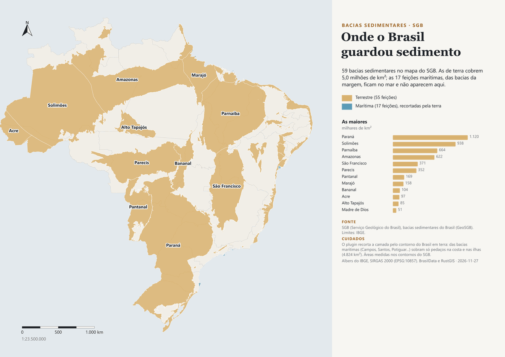

# Bacias sedimentares (SGB)

<!-- Gerado por scripts/gerar.py a partir do fontes.csv e do fichas.csv; não edite à mão. -->

Os contornos das bacias sedimentares brasileiras, terrestres e marítimas, do SGB.

*Mapa exemplo: Brasil, com o dado do plugin e a folha feita à parte no RustGIS.*

| | |
|---|---|
| **Onde na aba** | Meio físico › Geologia e recursos minerais. |
| **Fonte** | SGB (Serviço Geológico do Brasil) |
| **Período** | compilação atual do SGB |
| **Resolução ou escala** | escala de síntese nacional |
| **Unidades** | sem unidade |
| **Legenda** | Polígonos pelo nome da bacia e pelo tipo. |
| **Cuidados de uso** | Contornos de síntese, para a visão regional. As bacias de exploração de petróleo da ANP (Bacias sedimentares (ANP)) usam outros limites. |
| **Licença** | dados abertos do SGB; licença não declarada no serviço. |
| **Citação** | SGB (Serviço Geológico do Brasil), GeoSGB, Bacias sedimentares. |
| **App desktop** | sim |
| **App web** | sim |

[Todas as camadas](README.md)
