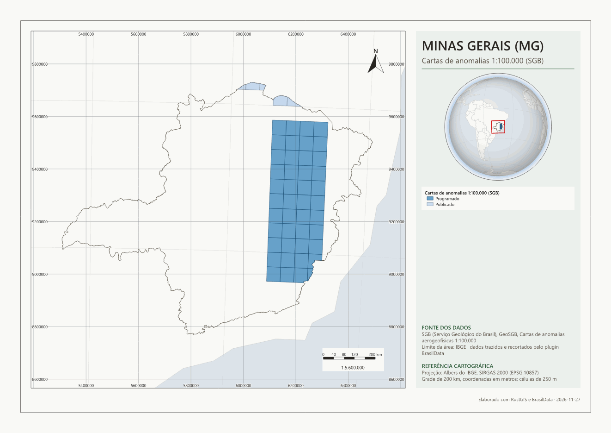

# Cartas de anomalias 1:100.000 (SGB)

<!-- Gerado por scripts/gerar.py a partir do fontes.csv e do fichas.csv; não edite à mão. -->

O índice das Cartas de Anomalias aerogeofísicas 1:100.000 do SGB, com o link do mapa em PDF e dos dados de cada folha.

*Mapa exemplo: Minas Gerais, feito com o plugin.*

| | |
|---|---|
| **Onde na aba** | Meio físico › Geofísica |
| **Fonte** | SGB (Serviço Geológico do Brasil) |
| **Período** | cartas publicadas desde 2015 (campo ano) |
| **Resolução ou escala** | folhas 1:100.000 |
| **Unidades** | sem unidade |
| **Legenda** | Polígonos das folhas, com o nome da área, o ano, a situação e os endereços do mapa (PDF) e dos dados. |
| **Cuidados de uso** | A camada é um índice: as anomalias estão nos mapas em PDF de cada folha. |
| **Licença** | dados abertos do SGB; licença não declarada no serviço. |
| **Citação** | SGB (Serviço Geológico do Brasil), GeoSGB, Cartas de anomalias aerogeofísicas 1:100.000. |
| **App desktop** | sim |
| **App web** | sim |

[Todas as camadas](README.md)
