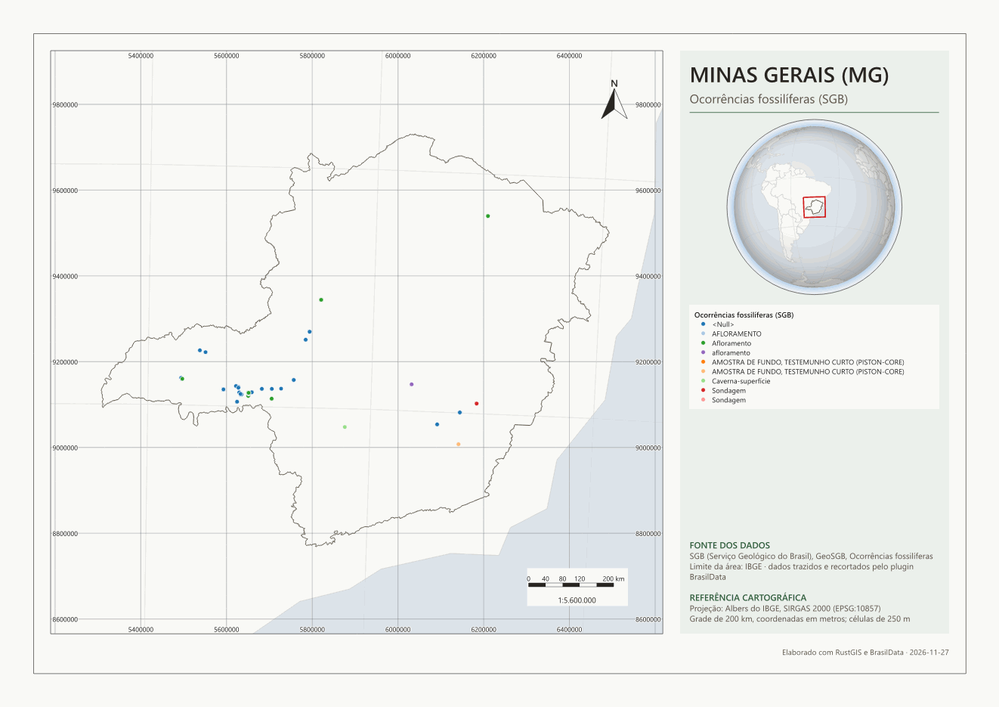

# Ocorrências fossilíferas (SGB)

<!-- Gerado por scripts/gerar.py a partir do fontes.csv e do fichas.csv; não edite à mão. -->

As ocorrências fossilíferas cadastradas pelo SGB, com o táxon, a unidade litoestratigráfica e o ambiente de deposição.

*Mapa exemplo: Minas Gerais, feito com o plugin.*

| | |
|---|---|
| **Onde na aba** | Meio físico › Geologia e recursos minerais. |
| **Fonte** | SGB (Serviço Geológico do Brasil) |
| **Período** | cadastro contínuo (campo data_atualizacao). |
| **Resolução ou escala** | pontos: o local da ocorrência |
| **Unidades** | sem unidade |
| **Legenda** | Pontos, com o táxon, a sistemática, o material, as unidades lito, crono e bioestratigráficas, a litologia e a referência bibliográfica. |
| **Cuidados de uso** | Os nomes de coletores e analistas ficam de fora. Sítios fossilíferos são protegidos por lei (Decreto-Lei 4.146/1942): a coleta pede autorização da ANM. |
| **Licença** | dados abertos do SGB; licença não declarada no serviço. |
| **Citação** | SGB (Serviço Geológico do Brasil), GeoSGB, Ocorrências fossilíferas. |
| **App desktop** | sim |
| **App web** | sim |

[Todas as camadas](README.md)
