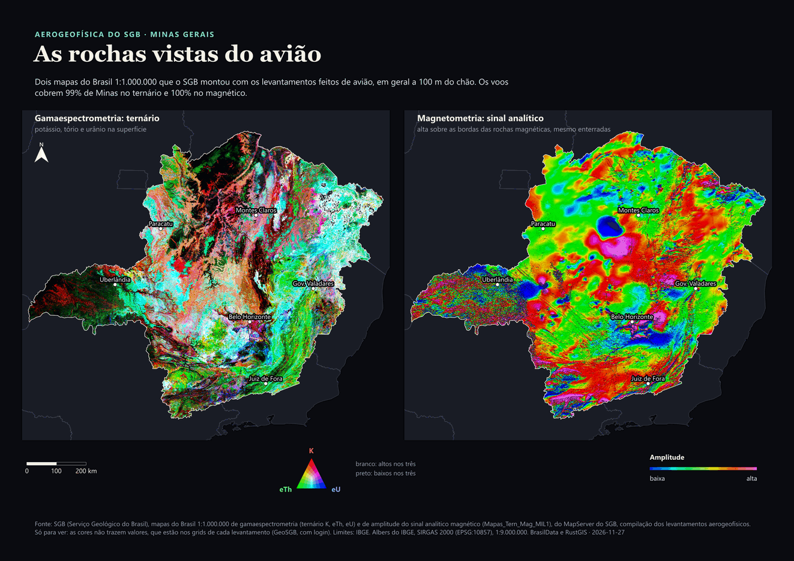

# Mapas de gama e magnetometria do Brasil (SGB)

<!-- Gerado por scripts/gerar.py a partir do fontes.csv e do fichas.csv; não edite à mão. -->

Os mapas do Brasil 1:1.000.000 do SGB, só para ver: o ternário de gamaespectrometria (potássio, tório e urânio em vermelho, verde e azul) ou a amplitude do sinal analítico magnético.

*Mapa exemplo: Minas Gerais, com o dado do plugin e a folha feita à parte no RustGIS.*

| | |
|---|---|
| **Onde na aba** | Meio físico › Geofísica |
| **Fonte** | SGB (Serviço Geológico do Brasil) |
| **Período** | compilação dos levantamentos aerogeofísicos do SGB. |
| **Resolução ou escala** | escala 1:1.000.000 |
| **Unidades** | sem unidade: imagens em cores |
| **Legenda** | Imagem por cima do mapa, a 85% de opacidade. No ternário, vermelho é potássio, verde é tório e azul é urânio; branco, altos nos três; preto, baixos nos três. |
| **Cuidados de uso** | Só para ver: não traz os valores e não é recortado pela área. Os valores estão nos grids de cada levantamento, na GeoSGB, com login. |
| **Licença** | dados abertos do SGB; licença não declarada no serviço. |
| **Citação** | SGB (Serviço Geológico do Brasil), Mapas do Brasil 1:1.000.000 de gamaespectrometria e de amplitude do sinal analítico magnético (Mapas_Tern_Mag_MIL1). |
| **App desktop** | sim |
| **App web** | sim: imagens do MapServer do SGB; ainda não testado. |

[Todas as camadas](README.md)
