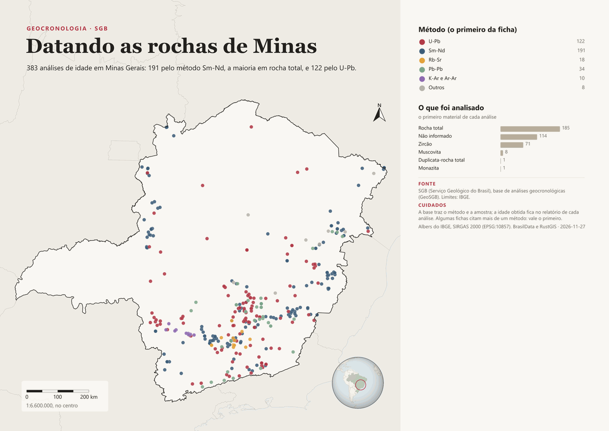

# Análises geocronológicas (SGB)

<!-- Gerado por scripts/gerar.py a partir do fontes.csv e do fichas.csv; não edite à mão. -->

As amostras de rocha com idade medida em laboratório (U-Pb, Sm-Nd, Rb-Sr, Ar-Ar...), da base de geocronologia do SGB.

*Mapa exemplo: Minas Gerais, com o dado do plugin e a folha feita à parte no RustGIS.*

| | |
|---|---|
| **Onde na aba** | Meio físico › Geologia e recursos minerais. |
| **Fonte** | SGB (Serviço Geológico do Brasil) |
| **Período** | análises de várias décadas |
| **Resolução ou escala** | pontos: o local da amostra, com o método de posicionamento e o erro locacional. |
| **Unidades** | sem unidade (as idades estão nos relatórios de cada análise). |
| **Legenda** | Pontos, com a rocha, os métodos, os materiais analisados e o nível de acesso. |
| **Cuidados de uso** | A camada diz onde há análise e por qual método, não a idade: os resultados de algumas amostras são de acesso restrito (campo nivel_acesso). A posição de muitas amostras vem de mapas de escala pequena (até 1:2.500.000). |
| **Licença** | dados abertos do SGB; licença não declarada no serviço. |
| **Citação** | SGB (Serviço Geológico do Brasil), GeoSGB, Geocronologia. |
| **App desktop** | sim |
| **App web** | sim |

[Todas as camadas](README.md)
