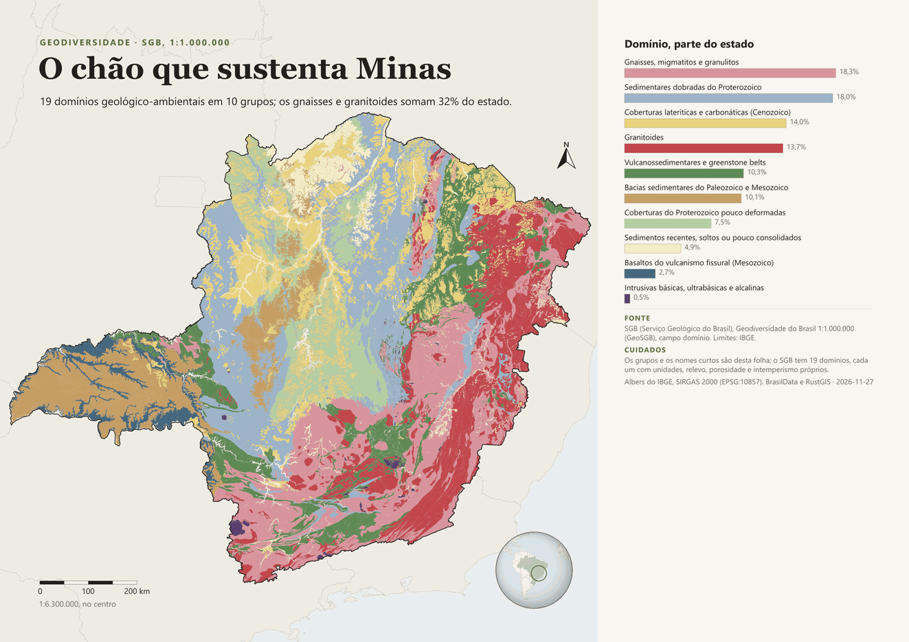

# Geodiversidade do Brasil, 1:1.000.000 (SGB)

<!-- Gerado por scripts/gerar.py a partir do fontes.csv e do fichas.csv; não edite à mão. -->

As unidades geológico-ambientais do Mapa de Geodiversidade do Brasil: a geologia lida pelo comportamento do terreno (relevo, intemperismo, porosidade, aquífero).

*Mapa exemplo: Minas Gerais, com o dado do plugin e a folha feita à parte no RustGIS.*

| | |
|---|---|
| **Onde na aba** | Meio físico › Geologia e recursos minerais. |
| **Fonte** | SGB (Serviço Geológico do Brasil) |
| **Período** | Mapa de Geodiversidade do Brasil (SGB), escala 1:1.000.000. |
| **Resolução ou escala** | escala 1:1.000.000 |
| **Unidades** | sem unidade |
| **Legenda** | Polígonos por unidade geológico-ambiental, com o domínio, os litotipos, o relevo, a declividade, a amplitude topográfica, a textura, a porosidade, o comportamento hidrogeológico e o intemperismo. |
| **Cuidados de uso** | Escala de síntese: para um município, use a geodiversidade estadual ou os mapas de detalhe do SGB. |
| **Licença** | dados abertos do SGB; licença não declarada no serviço. |
| **Citação** | SGB (Serviço Geológico do Brasil), GeoSGB, Mapa de Geodiversidade do Brasil, 1:1.000.000. |
| **App desktop** | sim |
| **App web** | sim |

[Todas as camadas](README.md)
