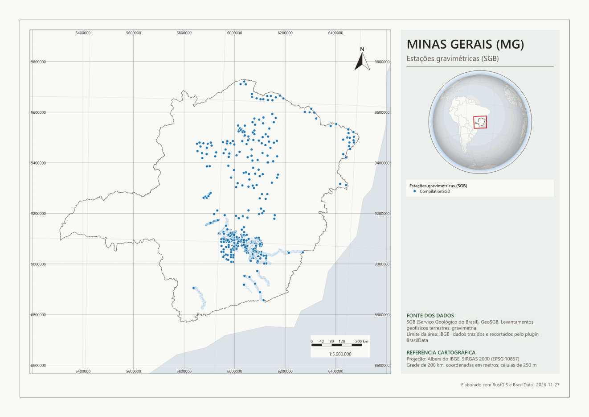

# Estações gravimétricas (SGB)

<!-- Gerado por scripts/gerar.py a partir do fontes.csv e do fichas.csv; não edite à mão. -->

As estações de gravimetria terrestre dos levantamentos do SGB e de parceiros: a gravidade medida e as anomalias ar-livre e Bouguer em cada ponto.

*Mapa exemplo: Minas Gerais, feito com o plugin.*

| | |
|---|---|
| **Onde na aba** | Meio físico › Geofísica |
| **Fonte** | SGB (Serviço Geológico do Brasil) |
| **Período** | levantamentos de várias décadas (campo Date). |
| **Resolução ou escala** | pontos: as estações, com o espaçamento de cada levantamento. |
| **Unidades** | mGal (Gravity, FreeAir, Bouguer, CompBouguer); m (Elevation); g/cm³ (Density, a densidade da correção Bouguer). |
| **Legenda** | Pontos, com a gravidade observada, as anomalias ar-livre, Bouguer e Bouguer completa, a altitude e o projeto. |
| **Cuidados de uso** | As estações seguem estradas e trilhas: a cobertura é irregular, e interpolar entre levantamentos de épocas e métodos diferentes pede cuidado. |
| **Licença** | dados abertos do SGB; licença não declarada no serviço. |
| **Citação** | SGB (Serviço Geológico do Brasil), GeoSGB, Levantamentos geofísicos terrestres: gravimetria. |
| **App desktop** | sim |
| **App web** | sim |

[Todas as camadas](README.md)
