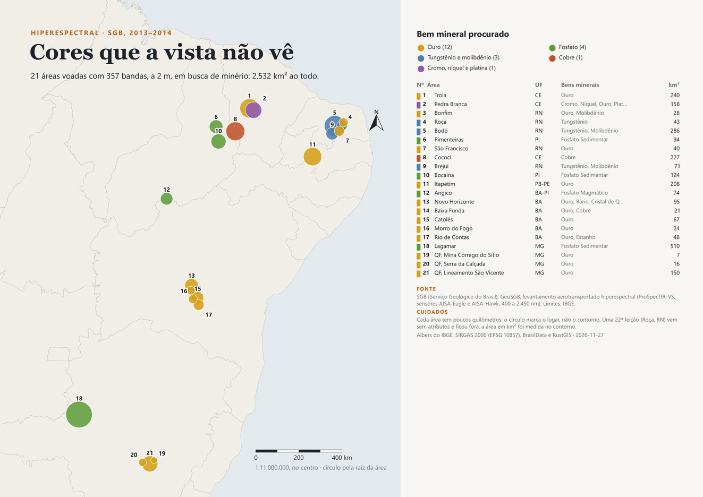

# Levantamentos hiperespectrais (SGB)

<!-- Gerado por scripts/gerar.py a partir do fontes.csv e do fichas.csv; não edite à mão. -->

As áreas dos levantamentos hiperespectrais aerotransportados do SGB, feitos para mapear minerais pela assinatura espectral.

*Mapa exemplo: Brasil, com o dado do plugin e a folha feita à parte no RustGIS.*

| | |
|---|---|
| **Onde na aba** | Meio físico › Geofísica |
| **Fonte** | SGB (Serviço Geológico do Brasil) |
| **Período** | levantamentos recentes (campo data) |
| **Resolução ou escala** | polígonos das áreas levantadas; a resolução espacial e espectral de cada uma nos campos res_espac e res_espect. |
| **Unidades** | km² (area_km2) |
| **Legenda** | Polígonos, com o bem mineral de interesse, o sistema imageador, os sensores, o número de bandas e as resoluções. |
| **Cuidados de uso** | A camada mostra onde há imagem, não a imagem: os cubos hiperespectrais ficam com o SGB. |
| **Licença** | dados abertos do SGB; licença não declarada no serviço. |
| **Citação** | SGB (Serviço Geológico do Brasil), GeoSGB, Levantamentos hiperespectrais aerotransportados. |
| **App desktop** | sim |
| **App web** | sim |

[Todas as camadas](README.md)
