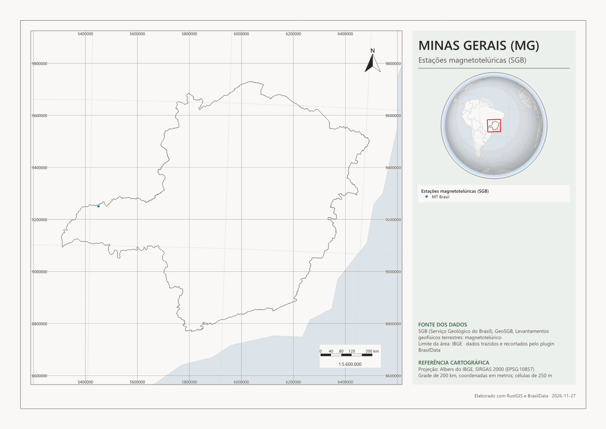

# Estações magnetotelúricas (SGB)

<!-- Gerado por scripts/gerar.py a partir do fontes.csv e do fichas.csv; não edite à mão. -->

As estações de sondagem magnetotelúrica (MT) do SGB e de parceiros, que medem a resistividade elétrica da crosta em profundidade.

*Mapa exemplo: Minas Gerais, feito com o plugin.*

| | |
|---|---|
| **Onde na aba** | Meio físico › Geofísica |
| **Fonte** | SGB (Serviço Geológico do Brasil) |
| **Período** | campanhas de várias datas (StartDate, EndDate). |
| **Resolução ou escala** | pontos: as estações |
| **Unidades** | m (Elevation); Hz (SampleFrequency) |
| **Legenda** | Pontos, com o projeto, o tipo de sondagem, as datas, a instituição e se os dados estão disponíveis. |
| **Cuidados de uso** | A camada diz onde houve sondagem, não a resistividade: os dados ficam com a instituição (campo DataAvailability). |
| **Licença** | dados abertos do SGB; licença não declarada no serviço. |
| **Citação** | SGB (Serviço Geológico do Brasil), GeoSGB, Levantamentos geofísicos terrestres: magnetotelúrico. |
| **App desktop** | sim |
| **App web** | sim |

[Todas as camadas](README.md)
