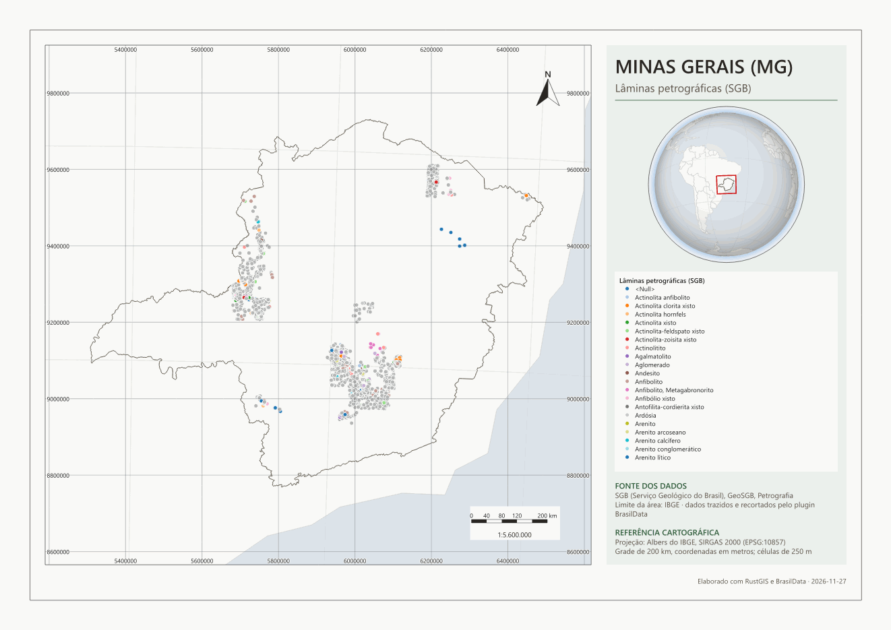

# Lâminas petrográficas (SGB)

<!-- Gerado por scripts/gerar.py a partir do fontes.csv e do fichas.csv; não edite à mão. -->

As lâminas petrográficas descritas pelo SGB: a rocha, o protolito e os minerais identificados ao microscópio.

*Mapa exemplo: Minas Gerais, feito com o plugin.*

| | |
|---|---|
| **Onde na aba** | Meio físico › Geologia e recursos minerais. |
| **Fonte** | SGB (Serviço Geológico do Brasil) |
| **Período** | descrições de várias décadas |
| **Resolução ou escala** | pontos: o afloramento de onde veio a amostra. |
| **Unidades** | sem unidade |
| **Legenda** | Pontos, com a rocha, o protolito, os minerais identificados, a granulação, o grau de intemperismo e o endereço da ficha. |
| **Cuidados de uso** | Uma lâmina descreve uma amostra, não a unidade inteira. Os nomes dos petrógrafos ficam de fora. |
| **Licença** | dados abertos do SGB; licença não declarada no serviço. |
| **Citação** | SGB (Serviço Geológico do Brasil), GeoSGB, Petrografia. |
| **App desktop** | sim |
| **App web** | sim |

[Todas as camadas](README.md)
