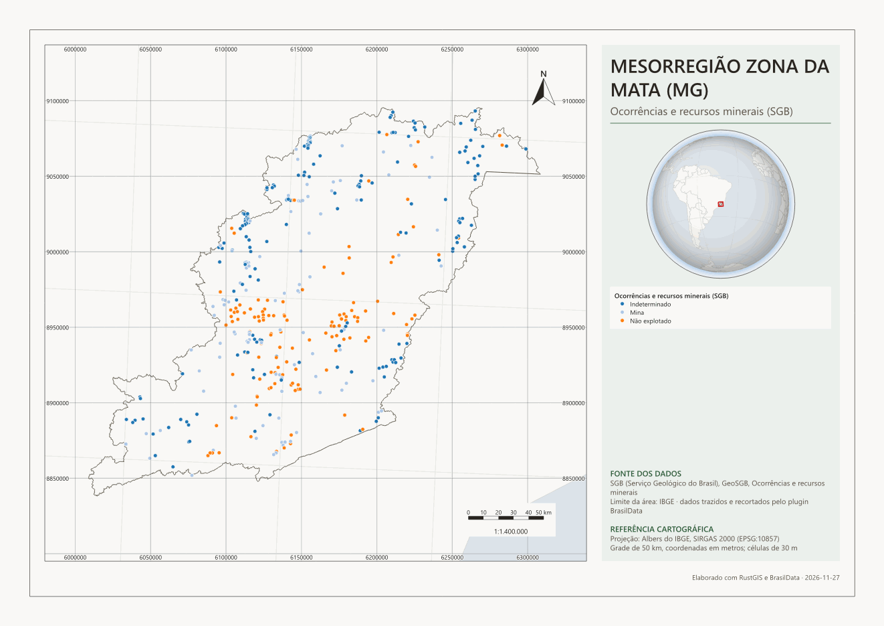

# Ocorrências e recursos minerais (SGB)

<!-- Gerado por scripts/gerar.py a partir do fontes.csv e do fichas.csv; não edite à mão. -->

As ocorrências, depósitos, garimpos e minas de recursos minerais cadastrados pelo Serviço Geológico do Brasil (base GEOSGB/Recursos Minerais).

*Mapa exemplo: Zona da Mata (MG), feito com o plugin.*

| | |
|---|---|
| **Onde na aba** | Meio físico › Geologia e recursos minerais. |
| **Fonte** | SGB (Serviço Geológico do Brasil) |
| **Período** | cadastro contínuo, de levantamentos de várias décadas (data do cadastro de cada ponto). |
| **Resolução ou escala** | pontos: a posição da ocorrência, com o método de posicionamento (GPS, carta 1:25.000, 1:100.000...). |
| **Unidades** | sem unidade |
| **Legenda** | Pontos, com as substâncias, as classes utilitárias (metais, rochas e minerais industriais, gemas...), o status econômico (ocorrência, depósito, mina), a importância e a situação da mina ou do garimpo. |
| **Cuidados de uso** | Uma ocorrência não é uma jazida em lavra nem um direito minerário: para os processos e títulos, use Processos minerários ativos (ANM). A posição de muitos pontos vem de cartas, com erro de centenas de metros (campo metodo_geoposicionamento). |
| **Licença** | domínio público (opendata.sgb.gov.br: livre para uso). |
| **Citação** | SGB (Serviço Geológico do Brasil), GeoSGB, Ocorrências e recursos minerais. |
| **App desktop** | sim |
| **App web** | sim |

[Todas as camadas](README.md)
