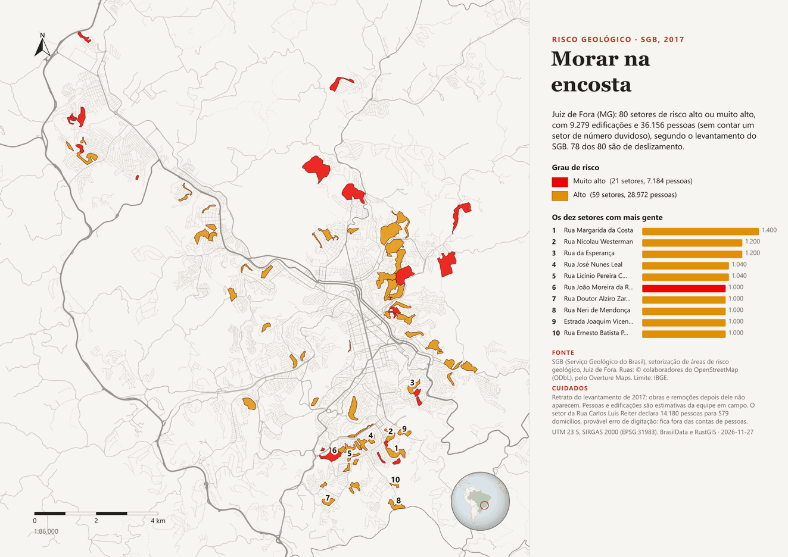

# Setores de risco geológico (SGB)

<!-- Gerado por scripts/gerar.py a partir do fontes.csv e do fichas.csv; não edite à mão. -->

Os setores de risco geológico alto e muito alto (deslizamento, queda de blocos, inundação, erosão...) mapeados pelo SGB nos municípios, com o número de moradias e de pessoas expostas.

*Mapa exemplo: Juiz de Fora (MG), com o dado do plugin e a folha feita à parte no RustGIS.*

| | |
|---|---|
| **Onde na aba** | Meio físico › Riscos geológicos |
| **Fonte** | SGB (Serviço Geológico do Brasil) |
| **Período** | setorizações de 2011 em diante (campo data_setor). |
| **Resolução ou escala** | polígonos dos setores, em escala de detalhe. |
| **Unidades** | número de edificações, domicílios e pessoas no setor. |
| **Legenda** | Polígonos pelo grau de risco (médio, alto, muito alto), com a tipologia do processo, a descrição, a vulnerabilidade e a sugestão de intervenção. |
| **Cuidados de uso** | Um setor retrata o dia do levantamento: obras e ocupações posteriores mudam o risco. A defesa civil do município tem a versão atual. |
| **Licença** | dados abertos do SGB; licença não declarada no serviço. |
| **Citação** | SGB (Serviço Geológico do Brasil), GeoSGB, Setorização de áreas de risco geológico. |
| **App desktop** | sim |
| **App web** | sim |

[Todas as camadas](README.md)
