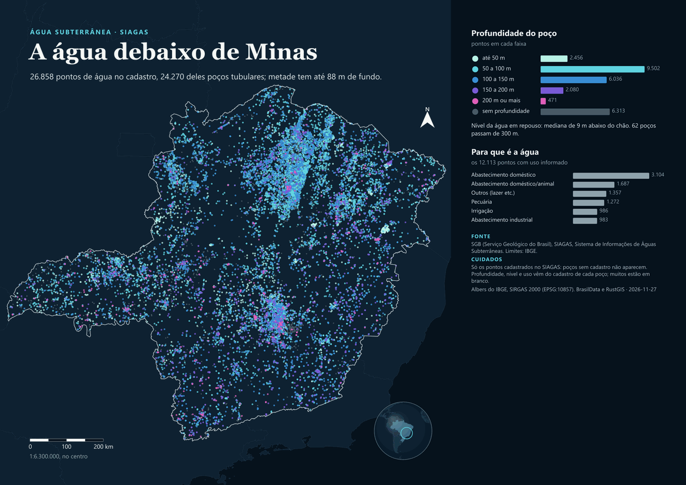

# Poços do SIAGAS (SGB)

<!-- Gerado por scripts/gerar.py a partir do fontes.csv e do fichas.csv; não edite à mão. -->

Os poços tubulares, cacimbas e fontes do SIAGAS, o Sistema de Informações de Águas Subterrâneas do SGB, com a profundidade, os níveis, a vazão e a qualidade da água.

*Mapa exemplo: Minas Gerais, com o dado do plugin e a folha feita à parte no RustGIS.*

| | |
|---|---|
| **Onde na aba** | Água › Recursos hídricos |
| **Fonte** | SGB (Serviço Geológico do Brasil) |
| **Período** | cadastro contínuo (data da perfuração e do cadastro de cada poço). |
| **Resolução ou escala** | pontos: a posição do poço |
| **Unidades** | m (profundidade, nível estático nd_m e dinâmico ne_m), m³/h/m (vazão específica), µS/cm (condutividade). |
| **Legenda** | Pontos, com a natureza do ponto, a situação, o uso da água, o aquífero, a profundidade, os níveis, a vazão específica, o pH e a condutividade, e o endereço da ficha do poço. |
| **Cuidados de uso** | Muitos poços têm só parte dos campos preenchida. O cadastro depende do que perfuradores e órgãos informam: não tem todos os poços. |
| **Licença** | dados abertos do SGB; licença não declarada no serviço. |
| **Citação** | SGB (Serviço Geológico do Brasil), SIAGAS, Sistema de Informações de Águas Subterrâneas. |
| **App desktop** | sim |
| **App web** | sim |

[Todas as camadas](README.md)
