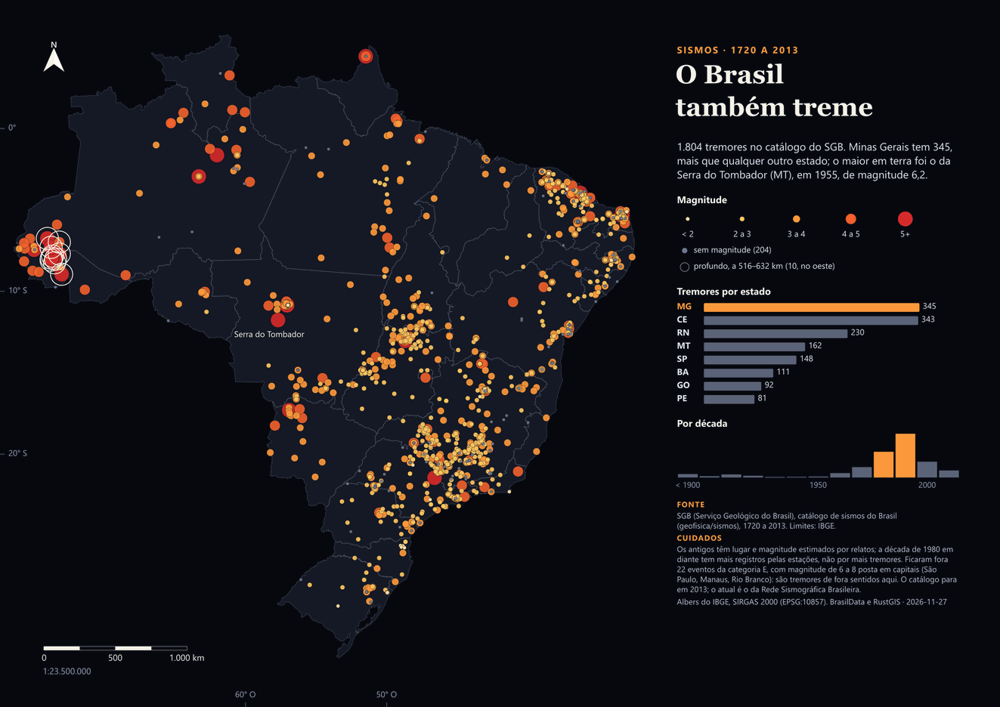

# Sismos (SGB, 1720 a 2013)

<!-- Gerado por scripts/gerar.py a partir do fontes.csv e do fichas.csv; não edite à mão. -->

Os sismos do catálogo do SGB: data, magnitude, profundidade, intensidade e localidade de cada evento sentido ou registrado no Brasil.

*Mapa exemplo: Brasil, com o dado do plugin e a folha feita à parte no RustGIS.*

| | |
|---|---|
| **Onde na aba** | Meio físico › Riscos geológicos |
| **Fonte** | SGB (Serviço Geológico do Brasil), pelo GeoSGB. |
| **Período** | de 1720 a 2013 |
| **Resolução ou escala** | pontos: o epicentro, com o erro de localização (os antigos, deduzidos dos relatos). |
| **Unidades** | magnitude (escala do catálogo, campo magnitude_num); km (PROFUNDIDADE); IO, a intensidade Mercalli no epicentro. |
| **Legenda** | Pontos coloridos pela magnitude: menos de 2, 2 a 3, 3 a 4, 4 a 5 e 5 ou mais. |
| **Cuidados de uso** | O catálogo para em 2013: o boletim atual e mais completo é o da Rede Sismográfica Brasileira (RSBR, USP). Os eventos antigos têm posição e magnitude estimadas pelos relatos. Ficam de fora os 67 da categoria E: sismos de fora do Brasil (Chile, Peru, Bolívia) sentidos aqui, que o catálogo põe na cidade onde foram sentidos com a magnitude da origem. |
| **Licença** | dados abertos do SGB; licença não declarada no serviço. |
| **Citação** | SGB (Serviço Geológico do Brasil), catálogo de sismos do Brasil (geofisica/sismos), 1720 a 2013. |
| **App desktop** | sim |
| **App web** | sim: o ArcGIS do SGB libera a leitura pelo navegador; ainda não testado. |

[Todas as camadas](README.md)
