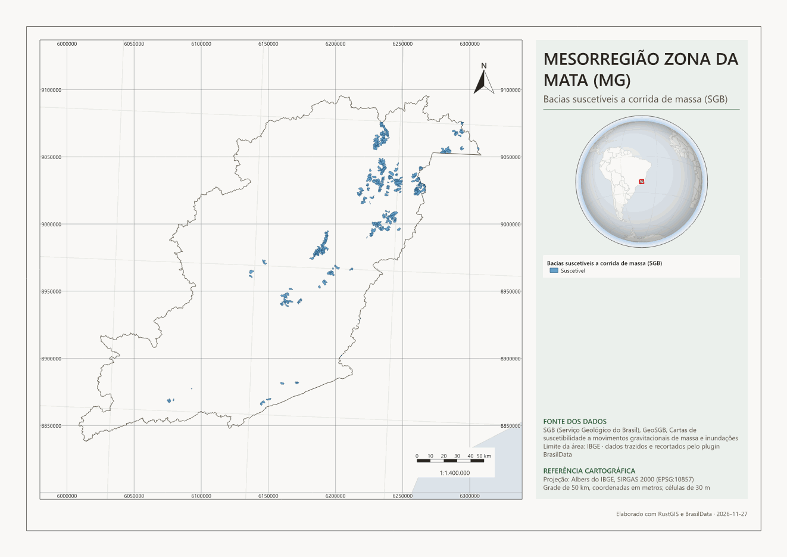

# Bacias suscetíveis a corrida de massa (SGB)

<!-- Gerado por scripts/gerar.py a partir do fontes.csv e do fichas.csv; não edite à mão. -->

As bacias de drenagem suscetíveis a corridas de massa (fluxos de detritos) das Cartas de Suscetibilidade do SGB.

*Mapa exemplo: Zona da Mata (MG), feito com o plugin.*

| | |
|---|---|
| **Onde na aba** | Meio físico › Riscos geológicos |
| **Fonte** | SGB (Serviço Geológico do Brasil) |
| **Período** | cartas de 2013 em diante (campo ano) |
| **Resolução ou escala** | bacias de drenagem, escala 1:25.000 |
| **Unidades** | área em km² (area_km2); índice de Melton (ind_melton). |
| **Legenda** | Polígonos das bacias suscetíveis, com a amplitude e o índice de Melton. |
| **Cuidados de uso** | Mostra só as bacias suscetíveis, não as outras. Suscetibilidade não é risco. |
| **Licença** | dados abertos do SGB; licença não declarada no serviço. |
| **Citação** | SGB (Serviço Geológico do Brasil), GeoSGB, Cartas de suscetibilidade a movimentos gravitacionais de massa e inundações. |
| **App desktop** | sim |
| **App web** | sim |

[Todas as camadas](README.md)
