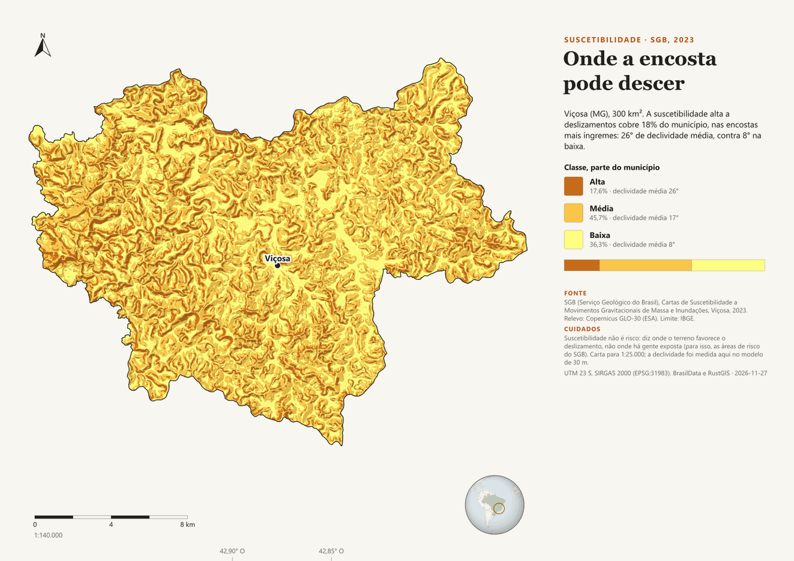

# Suscetibilidade a movimento de massa (SGB)

<!-- Gerado por scripts/gerar.py a partir do fontes.csv e do fichas.csv; não edite à mão. -->

As áreas suscetíveis a movimentos gravitacionais de massa (deslizamentos) das Cartas de Suscetibilidade do SGB, por município.

*Mapa exemplo: Viçosa (MG), com o dado do plugin e a folha feita à parte no RustGIS.*

| | |
|---|---|
| **Onde na aba** | Meio físico › Riscos geológicos |
| **Fonte** | SGB (Serviço Geológico do Brasil) |
| **Período** | cartas de 2013 em diante (campo ano) |
| **Resolução ou escala** | escala 1:25.000 |
| **Unidades** | área em km² (area_km2) |
| **Legenda** | Polígonos pela classe de suscetibilidade (alta, média, baixa), nas cores do SGB. |
| **Cuidados de uso** | Suscetibilidade não é risco: diz onde o terreno favorece o processo, sem considerar a ocupação. Os polígonos são muitos e pequenos: o plugin traz até 20 mil, a área de um município. |
| **Licença** | dados abertos do SGB; licença não declarada no serviço. |
| **Citação** | SGB (Serviço Geológico do Brasil), GeoSGB, Cartas de suscetibilidade a movimentos gravitacionais de massa e inundações. |
| **App desktop** | sim |
| **App web** | sim |

[Todas as camadas](README.md)
