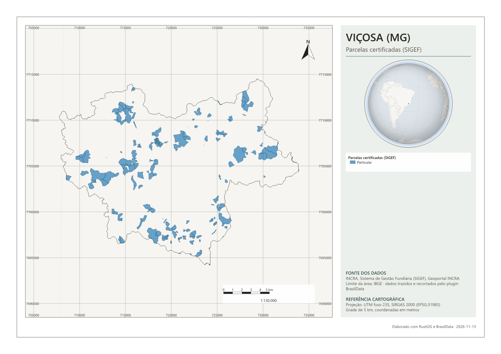

# Parcelas certificadas (SIGEF)

<!-- Gerado por scripts/gerar.py a partir do fontes.csv e do fichas.csv; não edite à mão. -->

As parcelas de imóveis rurais certificadas pelo INCRA no SIGEF.

*Mapa exemplo: Viçosa (MG), feito com o plugin.*

| | |
|---|---|
| **Onde na aba** | Território › Cadastro fundiário |
| **Fonte** | INCRA |
| **Período** | SIGEF, base vigente na data do pedido |
| **Resolução ou escala** | georreferenciamento certificado (precisão de cerca de 0,5 m nos vértices). |
| **Unidades** | área em ha (area_hectares) |
| **Legenda** | Polígonos pela natureza (particular, assentamento, gleba pública...), com o código do imóvel, a data de aprovação e a situação. |
| **Cuidados de uso** | Só os imóveis já certificados: muitas propriedades ainda não estão no SIGEF. Para posse e domínio, a matrícula do cartório. |
| **Licença** | licença não declarada no serviço |
| **Citação** | INCRA, Sistema de Gestão Fundiária (SIGEF), Geoportal INCRA. |
| **App desktop** | sim |
| **App web** | sim |

[Todas as camadas](README.md)
