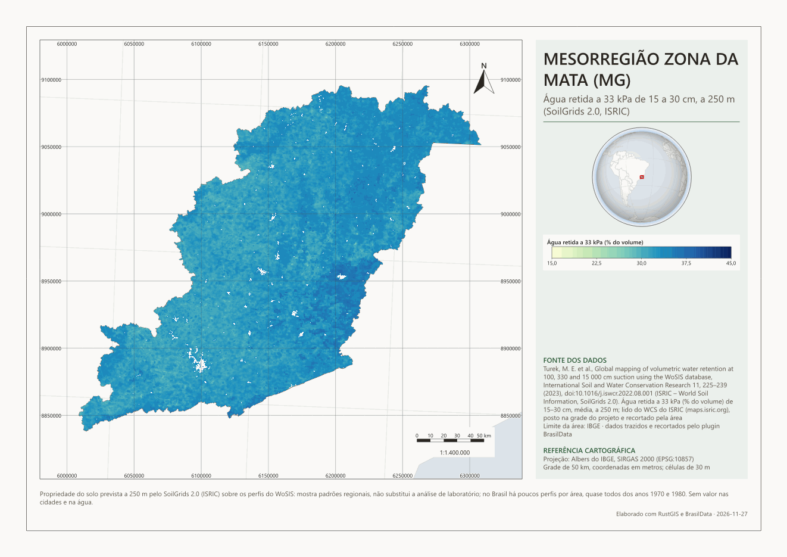

# Propriedades do solo a 250 m (SoilGrids)

<!-- Gerado por scripts/gerar.py a partir do fontes.csv e do fichas.csv; não edite à mão. -->

Uma propriedade do solo a 250 m do SoilGrids 2.0 (ISRIC – World Soil Information): argila, areia, silte, carbono orgânico, densidade e estoque de carbono, pH em água, CTC a pH 7, nitrogênio, densidade do solo, fragmentos grossos e água retida a 10, 33 e 1500 kPa, em seis camadas de 0 a 200 cm, prevista por florestas aleatórias de quantis sobre os perfis do WoSIS, com a média, a mediana, os quantis de 5 e 95% e a incerteza.

*Mapa exemplo: Zona da Mata (MG), feito com o plugin.*

| | |
|---|---|
| **Onde na aba** | Meio físico › Solos |
| **Fonte** | ISRIC – World Soil Information |
| **Período** | sem data: os perfis do WoSIS vão dos anos 1950 a 2010 (no Brasil, quase todos dos anos 1970 e 1980); SoilGrids 2.0 de 2020 (a água retida, de 2023). |
| **Resolução ou escala** | 250 m (na projeção Homolosine de Goode); numa área grande, o serviço reduz a imagem pelo vizinho mais próximo (500 m, 750 m...). |
| **Unidades** | % (argila, areia e silte), g/kg (carbono e nitrogênio), kg/m³ (densidade de carbono), t/ha (estoque de carbono de 0 a 30 cm), pH, cmolc/kg (CTC), g/cm³ (densidade do solo) e % do volume (fragmentos grossos e água retida); a incerteza não tem unidade. |
| **Legenda** | Escala contínua: a argila, a areia e o silte de 0 a 80 %; o carbono de 0 a 60 g/kg; o pH do vermelho (ácido, 4) ao verde (alcalino, 8,5); a CTC em roxo, de 0 a 30 cmolc/kg; a água retida em azul (20 a 50 % a 10 kPa, 15 a 45 % a 33 kPa, 5 a 35 % a 1500 kPa); a incerteza de 0 a 5. |
| **Cuidados de uso** | Previsões de um modelo global, não análises de laboratório: no Brasil há poucos perfis por área, e quase todos antigos, então o mapa mostra padrões regionais, não a fazenda. Veja a incerteza: acima de 1, o intervalo de 90% é mais largo que a própria mediana. Nas cidades e na água não há valor. Para 30 m, o OpenLandMap; para medidas, os pontos do SoilData e do WoSIS. |
| **Licença** | CC BY 4.0 |
| **Citação** | Poggio, L. et al., SoilGrids 2.0: producing soil information for the globe with quantified spatial uncertainty, SOIL 7, 217–240 (2021), doi:10.5194/soil-7-217-2021; a água retida: Turek, M. E. et al., International Soil and Water Conservation Research 11, 225–239 (2023), doi:10.1016/j.iswcr.2022.08.001. |
| **App desktop** | sim |
| **App web** | sim (o serviço do ISRIC libera a leitura pelo navegador). |

[Todas as camadas](README.md)
