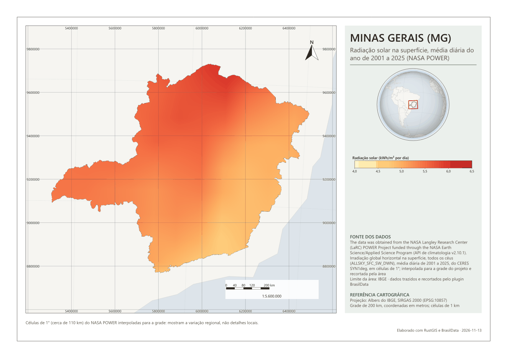

# Radiação solar (NASA POWER)

<!-- Gerado por scripts/gerar.py a partir do fontes.csv e do fichas.csv; não edite à mão. -->

A irradiação solar global horizontal na superfície, com todos os céus (nuvens incluídas).

*Mapa exemplo: Minas Gerais, feito com o plugin.*

| | |
|---|---|
| **Onde na aba** | Meio físico › Clima |
| **Fonte** | NASA Langley (POWER) |
| **Período** | média diária de 2001 a 2025, do ano ou de um mês. |
| **Resolução ou escala** | 1° (cerca de 110 km), interpolada para a grade do projeto. |
| **Unidades** | kWh/m² por dia |
| **Legenda** | Escala contínua de cores. |
| **Cuidados de uso** | Em células de 1°: o mapa mostra a variação regional, não o efeito do relevo nem das encostas. |
| **Licença** | política de dados da NASA: uso livre e gratuito, com a citação. |
| **Citação** | NASA Langley Research Center (LaRC) POWER Project, API de climatologia v2.10.1, ALLSKY_SFC_SW_DWN (CERES SYN1deg). |
| **App desktop** | sim |
| **App web** | sim |

[Todas as camadas](README.md)
