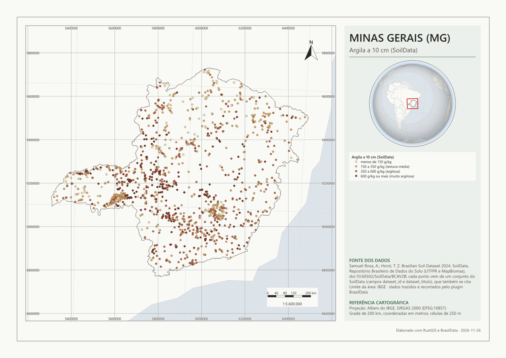

# Pontos de solo: análises de laboratório (SoilData)

<!-- Gerado por scripts/gerar.py a partir do fontes.csv e do fichas.csv; não edite à mão. -->

As camadas de solo descritas e analisadas nos levantamentos e pesquisas publicados no SoilData, o Repositório Brasileiro de Dados do Solo: argila, areia, silte, carbono orgânico, CTC, pH e densidade do solo de cada camada, e a classe do solo de cada perfil, juntados no Brazilian Soil Dataset 2024.

*Mapa exemplo: Minas Gerais, feito com o plugin.*

| | |
|---|---|
| **Onde na aba** | Meio físico › Solos |
| **Fonte** | SoilData (Laboratório de Pedometria da UTFPR e MapBiomas). |
| **Período** | coletas de 1958 a 2024 (mediana 1997); um ano por conjunto, quando o levantamento o diz. |
| **Resolução ou escala** | pontos: um perfil ou uma amostra; a precisão da coordenada (campo coord_precisao, em metros) vai de 1 m a mais de 1 km e falta em 40% das camadas. |
| **Unidades** | g/kg (argila, areia, silte e carbono orgânico), cmolc/kg (CTC), pH, g/cm³ (densidade do solo). |
| **Legenda** | Pontos coloridos pela classe do atributo na camada que contém a profundidade escolhida (5, 10, 30, 50 ou 100 cm), com o valor no campo de unidade no nome (argila_gkg, carbono_gkg, ctc_cmolc_kg, ph_medido, densidade_gcm3...); a argila nos grupos de textura do SiBCS (abaixo de 150, 150 a 350, 350 a 600 e 600 g/kg ou mais) e o pH nas classes de reação da Embrapa. Na classe do solo, um ponto por perfil, colorido pela ordem do SiBCS. Cada ponto traz o conjunto de origem (dataset_id e dataset_titulo), a licença, o ano, a profundidade da camada e a classe como o levantamento a escreveu (taxon_sibcs). |
| **Cuidados de uso** | Medidas de laboratório de métodos e épocas diferentes, juntadas e padronizadas pelo SoilData: compare com cuidado conjuntos distantes no tempo. A distribuição é muito desigual: mais de um quarto das camadas é de Rondônia (Inventário Florestal Nacional), e há regiões quase sem pontos. As coordenadas antigas podem vir de mapas ou do centro do município (campo coord_fonte). A classe do solo antiga (antes de 1999) é posta na ordem atual mais próxima, o que é aproximado (um Podzólico Vermelho-Escuro pode ser hoje um Nitossolo); o nome original fica no campo taxon_sibcs. Cada ponto tem a licença do conjunto de origem, e 40% das camadas são CC BY-NC 4.0, sem uso comercial. O pH não diz o método (deve ser em água). Para um mapa contínuo das propriedades, as do OpenLandMap. |
| **Licença** | CC BY 4.0 (o arquivo); cada ponto com a licença do conjunto de origem: CC BY 4.0 ou CC BY-NC 4.0 (sem uso comercial). |
| **Citação** | Samuel-Rosa, A.; Horst, T. Z., Brazilian Soil Dataset 2024, SoilData, doi:10.60502/SoilData/BCAV2B; e o conjunto de origem de cada ponto (dataset_id e dataset_titulo). |
| **App desktop** | sim |
| **App web** | ainda não testado: o repositório libera a leitura pelo navegador. |

[Todas as camadas](README.md)
