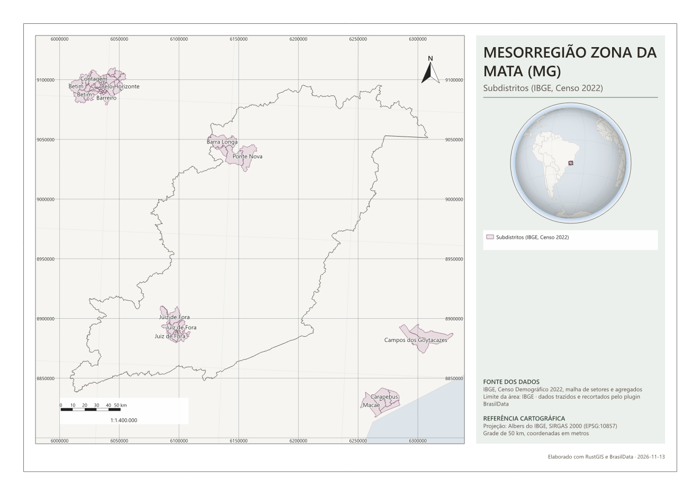

# Subdistritos (IBGE, Censo 2022)

<!-- Gerado por scripts/gerar.py a partir do fontes.csv e do fichas.csv; não edite à mão. -->

Os subdistritos, divisões de alguns distritos que só existem em parte dos municípios (sobretudo capitais).

*Mapa exemplo: Zona da Mata (MG), feito com o plugin.*

| | |
|---|---|
| **Onde na aba** | Território › Limites |
| **Fonte** | IBGE |
| **Período** | malha de setores do Censo Demográfico 2022. |
| **Resolução ou escala** | escala cadastral dos setores censitários |
| **Unidades** | sem unidade |
| **Legenda** | Um polígono por subdistrito, com o código e o nome. |
| **Cuidados de uso** | Limites para mapas e estatística, não para demarcação legal. Vem o polígono inteiro de cada unidade que cruza a área, sem recorte. A maioria dos municípios não tem subdistritos. |
| **Licença** | uso livre com citação da fonte |
| **Citação** | IBGE, Censo Demográfico 2022, malha de setores e agregados. |
| **App desktop** | sim |
| **App web** | sim |

[Todas as camadas](README.md)
