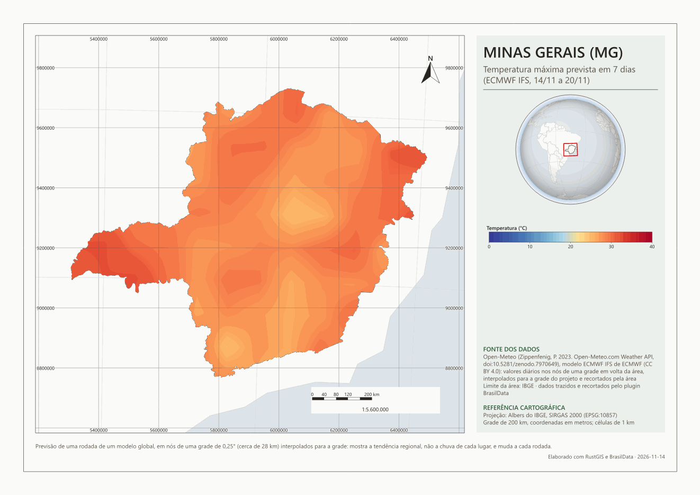

# Temperatura prevista (Open-Meteo)

<!-- Gerado por scripts/gerar.py a partir do fontes.csv e do fichas.csv; não edite à mão. -->

A temperatura do ar a 2 m prevista para os próximos dias por um modelo global: a média da máxima do dia, da mínima ou da média, nos dias pedidos.

*Mapa exemplo: Minas Gerais, feito com o plugin.*

| | |
|---|---|
| **Onde na aba** | Tempo e clima › Previsão |
| **Fonte** | Open-Meteo, com os modelos do ECMWF, da NOAA e do DWD. |
| **Período** | de hoje até 16 dias à frente (15 nos modelos do ECMWF, 7 no ICON), da rodada mais recente do modelo. |
| **Resolução ou escala** | nós de uma grade de 0,25° (cerca de 28 km) em volta da área, ajustados à altitude de cada nó, interpolados para a grade do projeto. |
| **Unidades** | °C |
| **Legenda** | Escala contínua de 0 °C (azul-escuro) a 40 °C (vermelho-escuro), com o amarelo-claro em torno de 22 °C. |
| **Cuidados de uso** | Mostra a variação regional, não o frio dos vales em noites claras nem a ilha de calor das cidades. A mínima prevista costuma errar mais que a máxima em terreno acidentado. |
| **Licença** | CC BY 4.0 (Open-Meteo; dados do ECMWF e do DWD em CC BY 4.0, da NOAA em domínio público); a API gratuita do Open-Meteo é para uso não comercial. |
| **Citação** | Open-Meteo (Zippenfenig, P. 2023. Open-Meteo.com Weather API, doi:10.5281/zenodo.7970649), com o modelo escolhido: ECMWF IFS ou AIFS (ECMWF), GFS (NOAA/NCEP) ou ICON (DWD). |
| **App desktop** | sim |
| **App web** | sim |

[Todas as camadas](README.md)
