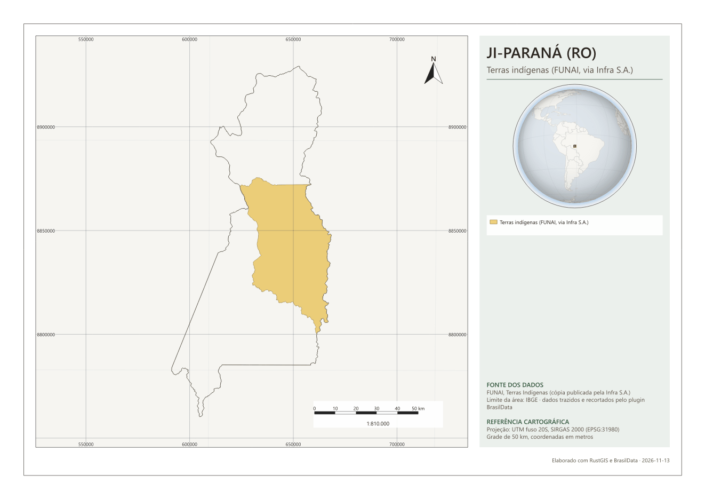

# Terras indígenas (FUNAI, via Infra S.A.)

<!-- Gerado por scripts/gerar.py a partir do fontes.csv e do fichas.csv; não edite à mão. -->

As terras indígenas em todas as fases do processo de demarcação (em estudo, declarada, homologada, regularizada).

*Mapa exemplo: Ji-Paraná (RO), feito com o plugin.*

| | |
|---|---|
| **Onde na aba** | Território › Terras indígenas |
| **Fonte** | FUNAI |
| **Período** | base da FUNAI copiada pela Infra S.A. |
| **Resolução ou escala** | limites da demarcação (escala variável) |
| **Unidades** | área em ha |
| **Legenda** | Polígonos pela fase do processo, com o nome, a etnia e o município. |
| **Cuidados de uso** | Cópia de terceiros: confira a fase na FUNAI. Terras em estudo podem não ter limite definido. |
| **Licença** | reprodução permitida citando a fonte (FUNAI). |
| **Citação** | FUNAI, Terras Indígenas (cópia publicada pela Infra S.A.). |
| **App desktop** | sim |
| **App web** | sim |

[Todas as camadas](README.md)
