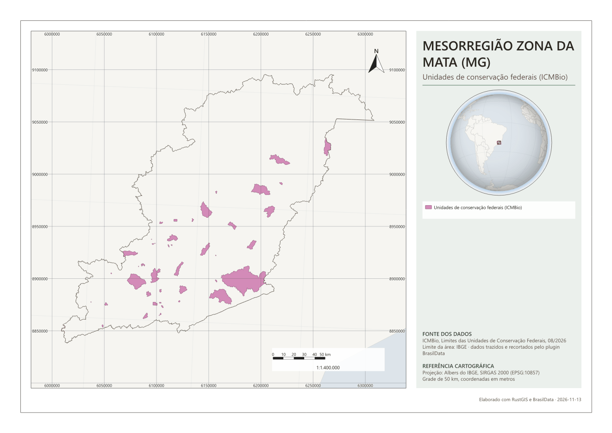

# Unidades de conservação federais (ICMBio)

<!-- Gerado por scripts/gerar.py a partir do fontes.csv e do fichas.csv; não edite à mão. -->

Os limites das unidades de conservação federais, publicados pelo ICMBio.

*Mapa exemplo: Zona da Mata (MG), feito com o plugin.*

| | |
|---|---|
| **Onde na aba** | Vegetação e meio ambiente › Áreas protegidas. |
| **Fonte** | ICMBio |
| **Período** | ICMBio, agosto de 2026 |
| **Resolução ou escala** | limites legais digitalizados |
| **Unidades** | área em ha |
| **Legenda** | Polígonos pela categoria, com o nome. |
| **Cuidados de uso** | Só as federais; as estaduais e municipais estão no CNUC. |
| **Licença** | não declarada no serviço |
| **Citação** | ICMBio, Limites das Unidades de Conservação Federais, 08/2026. |
| **App desktop** | sim |
| **App web** | sim |

[Todas as camadas](README.md)
