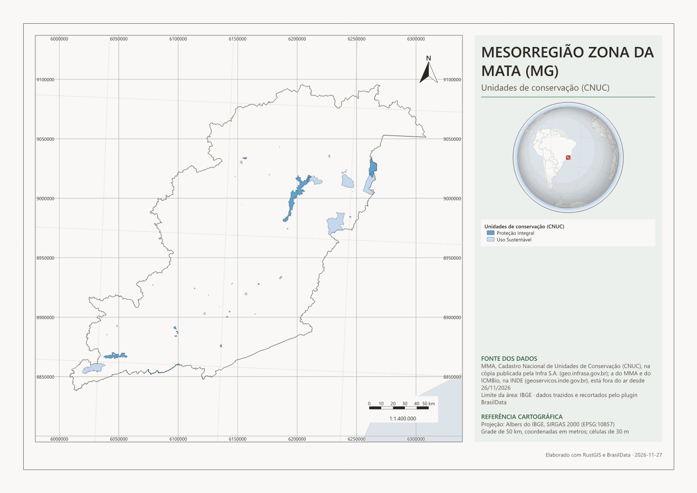

# Unidades de conservação (CNUC)

<!-- Gerado por scripts/gerar.py a partir do fontes.csv e do fichas.csv; não edite à mão. -->

As unidades de conservação federais, estaduais e municipais do Cadastro Nacional de Unidades de Conservação (CNUC), do MMA.

*Mapa exemplo: Zona da Mata (MG), feito com o plugin.*

| | |
|---|---|
| **Onde na aba** | Vegetação e meio ambiente › Áreas protegidas. |
| **Fonte** | MMA |
| **Período** | CNUC na cópia publicada pela Infra S.A. (criações até 2024). |
| **Resolução ou escala** | limites legais digitalizados (escala variável). |
| **Unidades** | área em ha (ha_total) |
| **Legenda** | Polígonos pela categoria (parque, APA, RPPN...) e pelo grupo (proteção integral ou uso sustentável), com o nome, a esfera, o órgão gestor, o ano e o ato de criação. |
| **Cuidados de uso** | Os limites são os declarados pelos gestores; APAs podem cobrir cidades inteiras. Confira o ato de criação para uso legal. O serviço do MMA na INDE está fora do ar desde 26/11/2026: a camada vem da cópia do CNUC publicada pela Infra S.A., que pode estar alguns meses atrás do MMA. |
| **Licença** | não declarada no serviço |
| **Citação** | MMA, Cadastro Nacional de Unidades de Conservação (CNUC), na cópia publicada pela Infra S.A. (geo.infrasa.gov.br); a do MMA e do ICMBio, na INDE (geoservicos.inde.gov.br), está fora do ar desde 26/11/2026. |
| **App desktop** | sim |
| **App web** | sim |

[Todas as camadas](README.md)
