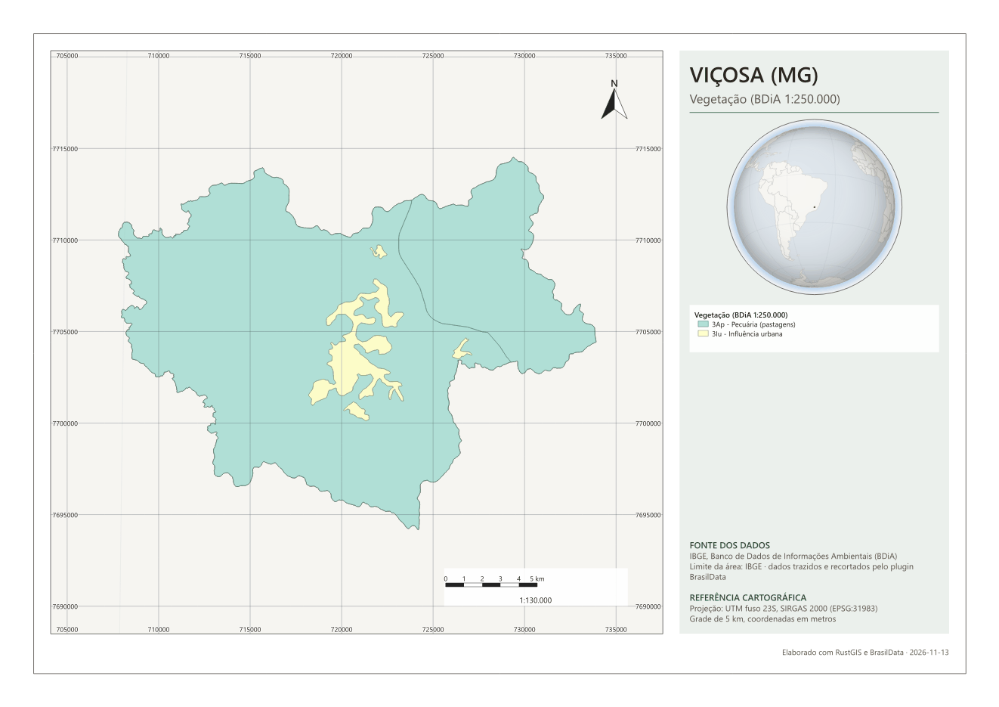

# Vegetação (BDiA 1:250.000)

<!-- Gerado por scripts/gerar.py a partir do fontes.csv e do fichas.csv; não edite à mão. -->

A vegetação: as regiões fitoecológicas (Floresta Estacional Semidecidual, Savana...) e as áreas de uso antrópico.

*Mapa exemplo: Viçosa (MG), feito com o plugin.*

| | |
|---|---|
| **Onde na aba** | Vegetação e meio ambiente › Vegetação |
| **Fonte** | IBGE |
| **Período** | mapeamento do Projeto RADAMBRASIL revisto pelo IBGE (anos 1970 a 2010), publicado no BDiA. |
| **Resolução ou escala** | escala 1:250.000 (área mínima mapeável de cerca de 2,5 km²). |
| **Unidades** | sem unidade; área do polígono em km² |
| **Legenda** | Polígonos pela legenda (legenda: o código e o nome da formação ou do uso), com a vegetação original estimada (veg_pretet) e os contatos. |
| **Cuidados de uso** | Escala regional: não substitui um levantamento detalhado da propriedade (1:10.000 a 1:50.000). Cada polígono é uma unidade de mapeamento, que pode ter inclusões de outras classes. Mostra a vegetação de quando a folha foi mapeada, não a atual; para o uso atual, o MapBiomas. |
| **Licença** | uso livre com citação da fonte |
| **Citação** | IBGE, Banco de Dados de Informações Ambientais (BDiA). |
| **App desktop** | sim |
| **App web** | sim |

[Todas as camadas](README.md)
