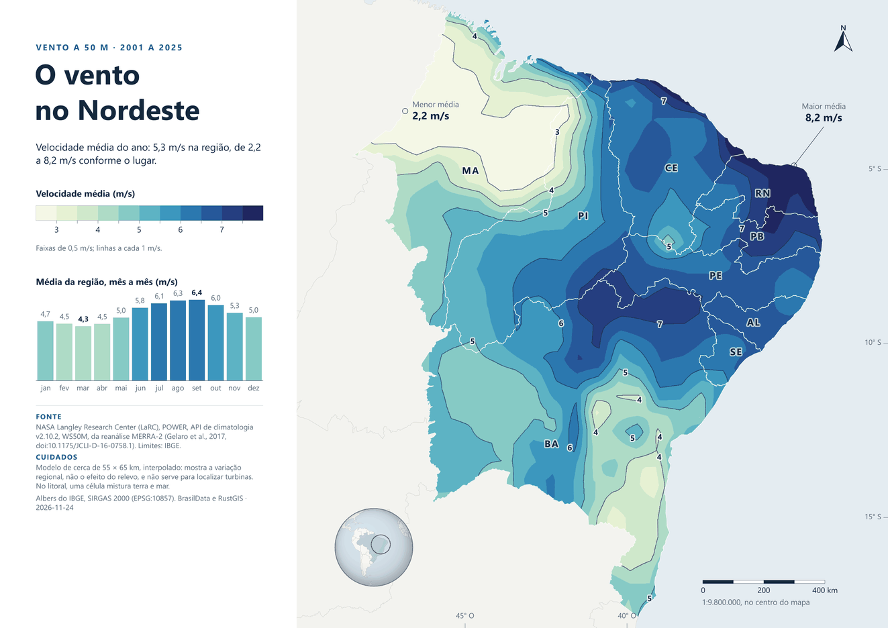

# Vento a 50 m (NASA POWER)

<!-- Gerado por scripts/gerar.py a partir do fontes.csv e do fichas.csv; não edite à mão. -->

A velocidade média do vento a 50 m de altura, da reanálise MERRA-2.

*Mapa exemplo: Região Nordeste, com o dado do plugin e a folha feita à parte no RustGIS.*

| | |
|---|---|
| **Onde na aba** | Tempo e clima › Clima |
| **Fonte** | NASA Langley (POWER) e NASA GMAO (MERRA-2). |
| **Período** | média de 2001 a 2025, do ano ou de um mês. |
| **Resolução ou escala** | 0,625° × 0,5° (cerca de 55 × 65 km), interpolada para a grade do projeto. |
| **Unidades** | m/s |
| **Legenda** | Viridis, de 1,5 a 8 m/s. |
| **Cuidados de uso** | É um modelo de cerca de 50 km: mostra a variação regional, não o efeito do relevo nem o vento de um lugar, e não serve para localizar turbinas. No litoral, uma célula mistura terra e mar. Não foi comparado com estações pelo BrasilData. Numa área com menos de umas 10 células, use o valor como regional. |
| **Licença** | política de dados da NASA: uso livre e gratuito, com a citação. |
| **Citação** | NASA Langley Research Center (LaRC) POWER Project, API de climatologia v2.10.2, WS50M (MERRA-2; Gelaro et al., 2017, doi:10.1175/JCLI-D-16-0758.1). |
| **App desktop** | sim |
| **App web** | No app web: a mesma API da radiação solar; ainda não testado no web. |

[Todas as camadas](README.md)
