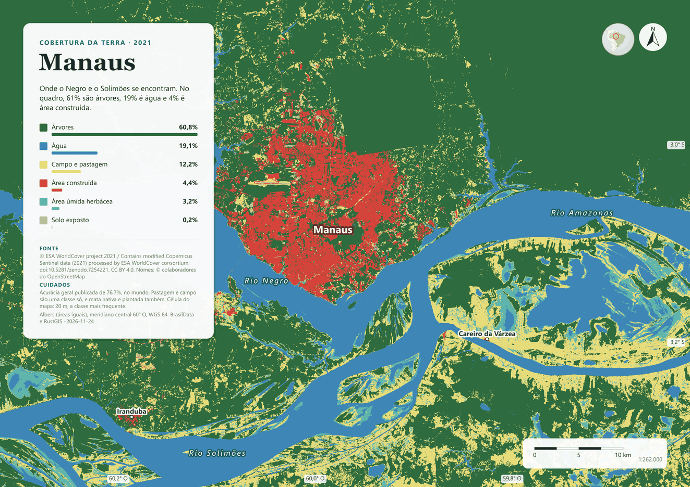

# Cobertura da terra a 10 m (ESA WorldCover)

<!-- Gerado por scripts/gerar.py a partir do fontes.csv e do fichas.csv; não edite à mão. -->

A cobertura da terra do ESA WorldCover a 10 m: onze classes num mapa mundial, feito com imagens do Sentinel-1 e do Sentinel-2 por um consórcio liderado pela VITO.

*Mapa exemplo: Manaus (AM), com o dado do plugin e a folha feita à parte no RustGIS.*

| | |
|---|---|
| **Onde na aba** | Vegetação e meio ambiente › Uso e cobertura. |
| **Fonte** | ESA WorldCover (ESA, consórcio liderado pela VITO), pelo Microsoft Planetary Computer. |
| **Período** | 2020 (versão 100 do algoritmo) ou 2021 (versão 200). |
| **Resolução ou escala** | 1/12.000° (cerca de 10 m), posta na grade do projeto com a classe mais frequente; numa grade mais grossa, a visão reduzida do arquivo (a classe mais frequente). |
| **Unidades** | classe (valor do pixel, de 10 a 100) |
| **Legenda** | As cores oficiais: 10 árvores (verde-escuro), 20 arbustos (laranja), 30 campo e pastagem (amarelo), 40 cultivos anuais (rosa), 50 área construída (vermelho), 60 solo exposto ou vegetação esparsa (cinza), 80 água (azul), 90 área úmida herbácea (azul-esverdeado), 95 manguezal (verde-água). |
| **Cuidados de uso** | Os mapas de 2020 e 2021 usam versões diferentes do algoritmo: a diferença entre eles mistura mudança do terreno e de método, e não se subtrai um do outro. A acurácia geral publicada é de 74,4% (2020) e 76,7% (2021), no mundo. Pelo manual do produto, pastagem e campo nativo são a mesma classe (30, que pode ter lavoura não cultivada no ano); floresta nativa e plantada também (10); cultivos (40) são só os anuais, e lavouras perenes lenhosas, como o café e a laranja, entram em árvores ou arbustos. Para o uso da terra no Brasil ano a ano, com pastagem e silvicultura separadas, o MapBiomas. Até 24 blocos de 3° por clique. |
| **Licença** | CC BY 4.0 |
| **Citação** | © ESA WorldCover project 2020 ou 2021 / Contains modified Copernicus Sentinel data (2020 ou 2021) processed by ESA WorldCover consortium. Zanaga, D. et al. (2021), ESA WorldCover 10 m 2020 v100, doi:10.5281/zenodo.5571936; Zanaga, D. et al. (2022), ESA WorldCover 10 m 2021 v200, doi:10.5281/zenodo.7254221. |
| **App desktop** | sim |
| **App web** | não (a leitura da janela remota só existe no desktop e na linha de comando). |

[Todas as camadas](README.md)
