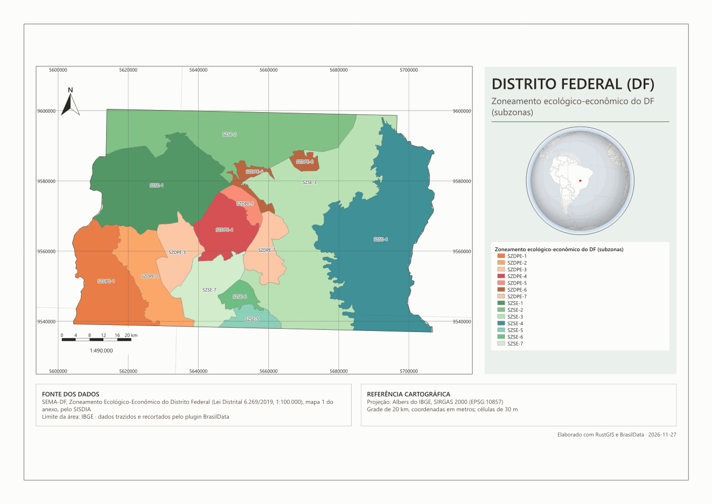

# Zoneamento ecológico-econômico do DF (subzonas)

<!-- Gerado por scripts/gerar.py a partir do fontes.csv e do fichas.csv; não edite à mão. -->

As subzonas do Zoneamento Ecológico-Econômico do Distrito Federal (ZEE-DF): as 7 subzonas da Zona de Diversificação Produtiva e Serviços Ecossistêmicos (SZSE) e as 7 da Zona de Dinamização Produtiva com Equidade (SZDPE).

*Mapa exemplo: Distrito Federal, feito com o plugin.*

| | |
|---|---|
| **Onde na aba** | Território › Zoneamento ecológico-econômico. |
| **Fonte** | SEMA-DF |
| **Período** | Lei Distrital 6.269, de 29/01/2019 |
| **Resolução ou escala** | 1:100.000 |
| **Unidades** | sem unidade |
| **Legenda** | As SZSE em verdes e as SZDPE em laranjas e vermelhos, com o código da subzona como rótulo. Campos: código da subzona, tema, unidade hidrográfica, código e nome da zona. |
| **Cuidados de uso** | É o zoneamento dos planos estaduais, não uma restrição por si: para o uso legal, confira a lei ou o decreto e o mapa oficial do anexo. As cores são do BrasilData, não as do mapa oficial. O SISDIA tem também os riscos ecológicos do ZEE (erosão, perda de cerrado, recarga e contaminação de aquíferos). |
| **Licença** | licença não declarada no serviço |
| **Citação** | SEMA-DF, Zoneamento Ecológico-Econômico do Distrito Federal (Lei Distrital 6.269/2019, 1:100.000), mapa 1 do anexo, pelo SISDIA. |
| **App desktop** | sim |
| **App web** | sim |

[Todas as camadas](README.md)
