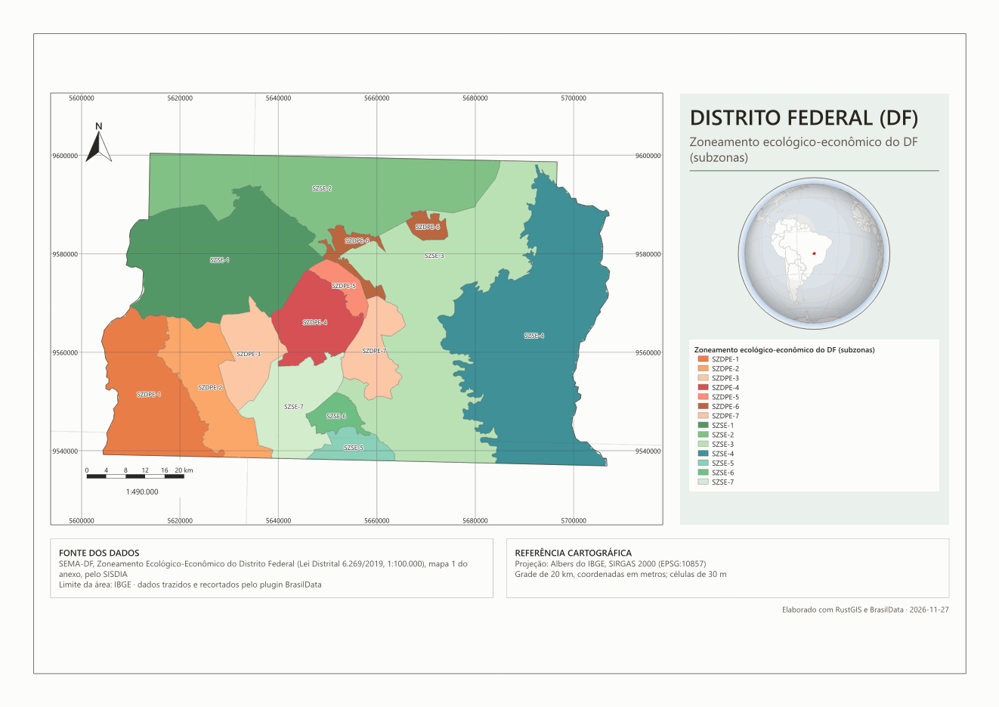

# ZEE do estado da área

<!-- Gerado por scripts/gerar.py a partir do fontes.csv e do fichas.csv; não edite à mão. -->

As zonas do Zoneamento Ecológico-Econômico do estado (ou dos estados) da área, pela fonte aberta de cada um: DF, PR (estadual e litoral), SE (o costeiro, só as zonas marítimas), MG e RO. Nos outros estados, o aviso diz o que existe e por que não vem.

*Mapa exemplo: Distrito Federal, feito com o plugin.*

| | |
|---|---|
| **Onde na aba** | Território › Zoneamento ecológico-econômico. |
| **Fonte** | órgãos ambientais e de planejamento dos estados. |
| **Período** | o de cada estado (DF 2019, PR 2016 e 2018, SE 2022, MG 2008, RO 2005). |
| **Resolução ou escala** | de 1:50.000 a 1:250.000, conforme o estado. |
| **Unidades** | sem unidade |
| **Legenda** | Cada zona numa cor, com a sigla ou o código como rótulo (as cores são do BrasilData). |
| **Cuidados de uso** | É o zoneamento dos planos estaduais, não uma restrição por si: para o uso legal, confira a lei ou o decreto e o mapa oficial do anexo. As cores são do BrasilData, não as do mapa oficial. Em 27/11/2026 estavam fora do ar os servidores do ZEE de CE, BA, MS, GO e SP; os de RS e MT pedem senha; AC, AM, AP, PA, PI, RN, PB, AL, ES e SC não têm as zonas em formato digital aberto. |
| **Licença** | não declarada nos serviços |
| **Citação** | A de cada estado (veja a ficha de cada camada). |
| **App desktop** | sim |
| **App web** | sim, menos Rondônia |

[Todas as camadas](README.md)
