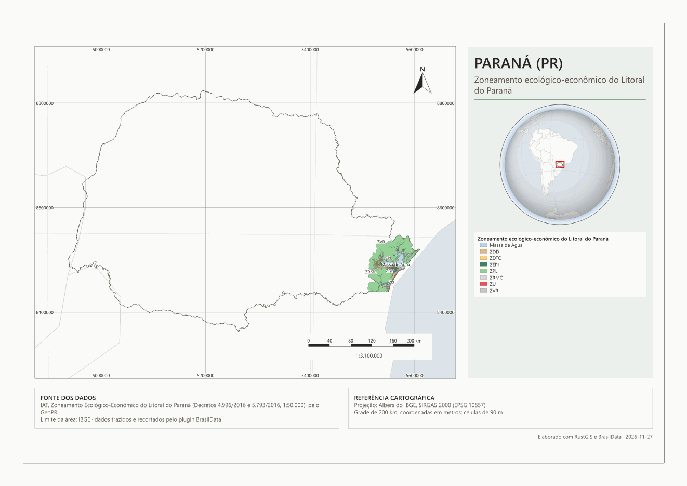

# Zoneamento ecológico-econômico do Litoral do Paraná

<!-- Gerado por scripts/gerar.py a partir do fontes.csv e do fichas.csv; não edite à mão. -->

As zonas do Zoneamento Ecológico-Econômico do Litoral do Paraná (prognóstico): urbana, de desenvolvimento, de expansão de unidades de conservação e protegidas por lei.

*Mapa exemplo: Paraná, feito com o plugin.*

| | |
|---|---|
| **Onde na aba** | Território › Zoneamento ecológico-econômico. |
| **Fonte** | IAT |
| **Período** | Decretos 4.996/2016 e 5.793/2016 |
| **Resolução ou escala** | 1:50.000 |
| **Unidades** | sem unidade |
| **Legenda** | Cada zona numa cor, com a sigla como rótulo (ZU, ZDTO, ZDD, ZEPI, ZPL...). |
| **Cuidados de uso** | É o zoneamento dos planos estaduais, não uma restrição por si: para o uso legal, confira a lei ou o decreto e o mapa oficial do anexo. As cores são do BrasilData, não as do mapa oficial. |
| **Licença** | licença não declarada no serviço |
| **Citação** | IAT, Zoneamento Ecológico-Econômico do Litoral do Paraná (Decretos 4.996/2016 e 5.793/2016, 1:50.000), pelo GeoPR. |
| **App desktop** | sim |
| **App web** | sim |

[Todas as camadas](README.md)
