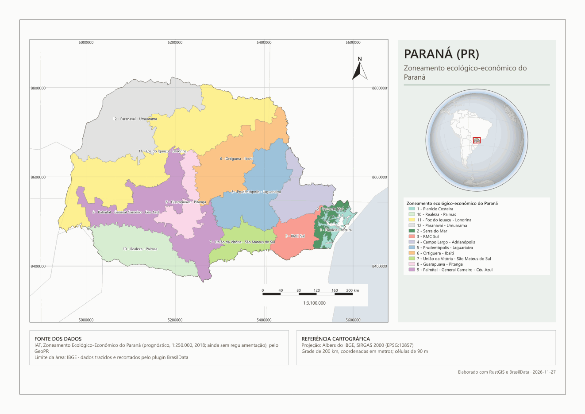

# Zoneamento ecológico-econômico do Paraná

<!-- Gerado por scripts/gerar.py a partir do fontes.csv e do fichas.csv; não edite à mão. -->

As 12 zonas do Zoneamento Ecológico-Econômico do Paraná (ZEE-PR), na etapa de prognóstico, do Instituto Água e Terra (IAT).

*Mapa exemplo: Paraná, feito com o plugin.*

| | |
|---|---|
| **Onde na aba** | Território › Zoneamento ecológico-econômico. |
| **Fonte** | IAT |
| **Período** | relatório de 2018; ainda sem regulamentação. |
| **Resolução ou escala** | 1:250.000 |
| **Unidades** | sem unidade |
| **Legenda** | Cada zona numa cor, com o nome como rótulo (de 1 Planície Costeira a 12 Paranavaí – Umuarama). |
| **Cuidados de uso** | É o zoneamento dos planos estaduais, não uma restrição por si: para o uso legal, confira a lei ou o decreto e o mapa oficial do anexo. As cores são do BrasilData, não as do mapa oficial. O ZEE-PR estadual ainda não foi regulamentado; o do Litoral é a camada ZEE do Litoral do Paraná. |
| **Licença** | licença não declarada no serviço |
| **Citação** | IAT, Zoneamento Ecológico-Econômico do Paraná (prognóstico, 1:250.000, 2018; ainda sem regulamentação), pelo GeoPR. |
| **App desktop** | sim |
| **App web** | sim |

[Todas as camadas](README.md)
