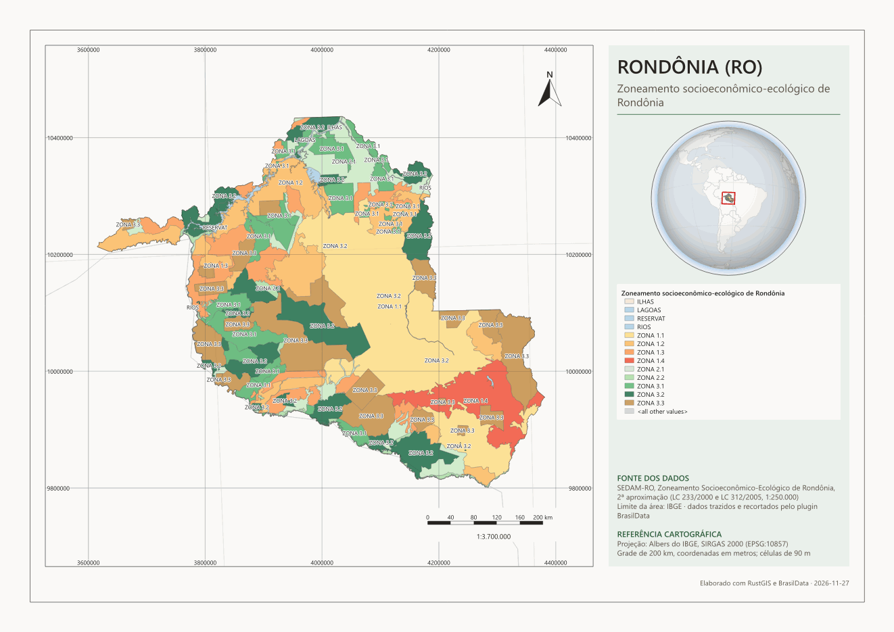

# Zoneamento socioeconômico-ecológico de Rondônia

<!-- Gerado por scripts/gerar.py a partir do fontes.csv e do fichas.csv; não edite à mão. -->

As subzonas do Zoneamento Socioeconômico-Ecológico de Rondônia (ZSEE-RO), 2ª aproximação: zona 1 (uso e ocupação), zona 2 (uso especial) e zona 3 (áreas institucionais: unidades de conservação e terras indígenas).

*Mapa exemplo: Rondônia, feito com o plugin.*

| | |
|---|---|
| **Onde na aba** | Território › Zoneamento ecológico-econômico. |
| **Fonte** | SEDAM-RO |
| **Período** | LC 233/2000, retificada pela LC 312/2005 (a atualização de 2020 foi vetada). |
| **Resolução ou escala** | 1:250.000 |
| **Unidades** | sem unidade |
| **Legenda** | A zona 1 em amarelos e laranjas, a 2 em verdes claros, a 3 em verdes escuros (unidades de conservação) e marrom (terras indígenas); a água em azul. Rótulo: a subzona. |
| **Cuidados de uso** | É o zoneamento dos planos estaduais, não uma restrição por si: para o uso legal, confira a lei ou o decreto e o mapa oficial do anexo. As cores são do BrasilData, não as do mapa oficial. |
| **Licença** | licença não declarada no serviço |
| **Citação** | SEDAM-RO, Zoneamento Socioeconômico-Ecológico de Rondônia, 2ª aproximação (LC 233/2000 e LC 312/2005, 1:250.000). |
| **App desktop** | sim |
| **App web** | não: só no app desktop (o servidor não aceita pedidos do navegador). |

[Todas as camadas](README.md)
