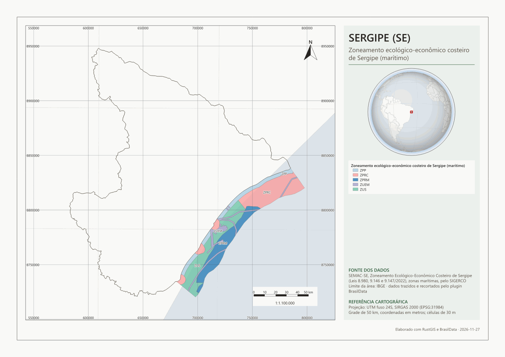

# Zoneamento ecológico-econômico costeiro de Sergipe (marítimo)

<!-- Gerado por scripts/gerar.py a partir do fontes.csv e do fichas.csv; não edite à mão. -->

As zonas marítimas do Zoneamento Ecológico-Econômico Costeiro de Sergipe (ZEEC-SE): proteção dos recifes de corais, para pesca e de recursos marítimos, uso sustentável e especial.

*Mapa exemplo: Sergipe, feito com o plugin.*

| | |
|---|---|
| **Onde na aba** | Território › Zoneamento ecológico-econômico. |
| **Fonte** | SEMAC-SE |
| **Período** | Leis 8.980, 9.146 e 9.147/2022 |
| **Resolução ou escala** | mapa geral 1:420.000 |
| **Unidades** | área em km² (Area_km2) |
| **Legenda** | Cada zona numa cor, com a sigla como rótulo (ZPRC, ZPP, ZUS, ZPRM, ZUEM). |
| **Cuidados de uso** | É o zoneamento dos planos estaduais, não uma restrição por si: para o uso legal, confira a lei ou o decreto e o mapa oficial do anexo. As cores são do BrasilData, não as do mapa oficial. As zonas ficam no mar: a camada vem inteira, sem o recorte pela área (que é em terra). As zonas terrestres do mesmo ZEEC não vêm: são 6 polígonos dissolvidos com o litoral inteiro, mais de 130 MB, pesados demais para o plugin. |
| **Licença** | licença não declarada no serviço |
| **Citação** | SEMAC-SE, Zoneamento Ecológico-Econômico Costeiro de Sergipe (Leis 8.980, 9.146 e 9.147/2022), zonas marítimas, pelo SIGERCO. |
| **App desktop** | sim |
| **App web** | sim |

[Todas as camadas](README.md)
